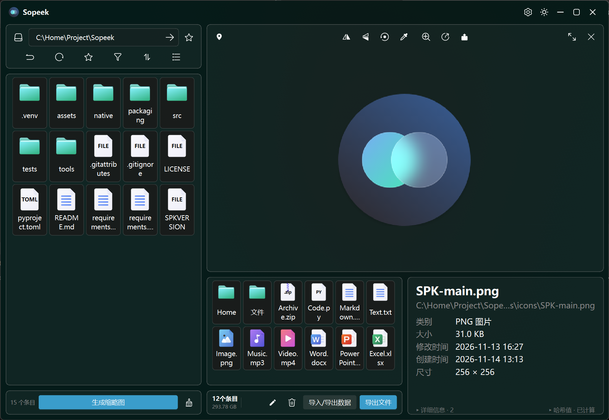
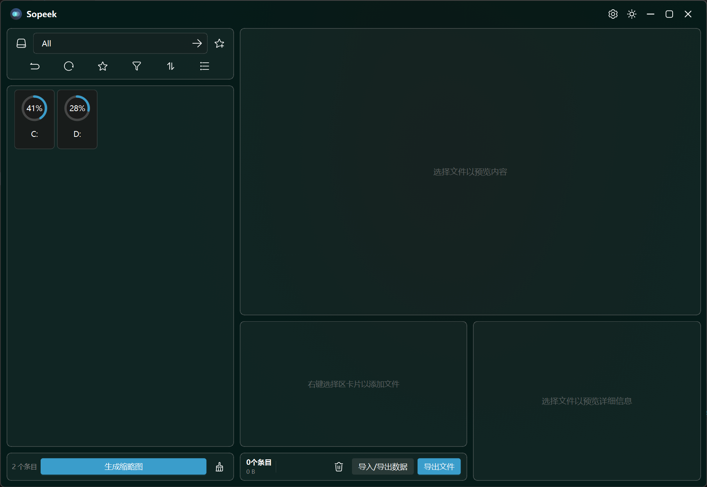
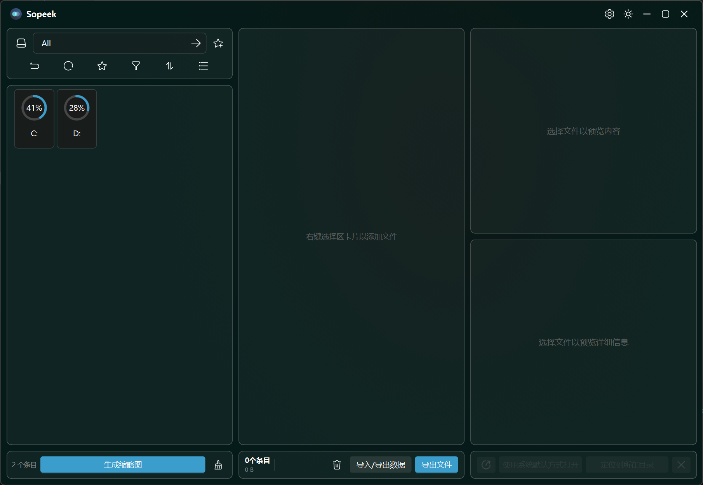

<div align="center">


# Sopeek

**一款强大的多功能文件预览与管理工具，让文件浏览如丝般高效顺滑**

[](LICENSE)[](https://www.python.org/)[](https://wiki.qt.io/Qt_for_Python)[](https://www.microsoft.com/windows)

[English](README_EN.md) • [快速开始](#快速开始) • [功能特性](#功能特性) • [支持格式](#支持格式) • [使用说明](#使用说明) • [常见问题](#常见问题) • [开发指南](#开发指南)



</div>

---

## 核心亮点

Sopeek 是一款面向 Windows 的桌面级文件浏览、筛选与预览工具。它把「找文件 → 挑文件 → 看文件」压缩进同一个工作流，内置 8 个预览器类（图像 / 视频音频 / PDF / Office / 文本代码 / 压缩包 / 字体 / 文件夹），可识别近 100 种扩展名：

- **浏览**：卡片式缩略图 / 列表双视图，框选多选、拖拽入池、收藏夹、历史导航；
- **整理**：文件储存池支持重命名、批量导出、路径数据导入导出与自动备份；
- **预览**：图像、视频、音频、PDF、Office、文本/代码、压缩包、字体、文件夹全覆盖；
- **纯键盘操作**：焦点区切换、文件导航、预览移交、入池、筛选排序与播放控制均可脱离鼠标完成；
- **性能**：扫描、排序、语法高亮、EXIF、哈希、编码探测、SVG 换色、7z 列表等热点由 Rust / C++ 原生扩展承担。

| 能力           | 说明                                                         |
| -------------- | ------------------------------------------------------------ |
| **统一工作流** | 文件选择器 + 文件储存池 + 预览器/信息面板，支持「经典」与「New」两种布局 |
| **多格式预览** | 8 个预览器覆盖图像、视频、音频、PDF、Office、文本/代码、压缩包、字体与文件夹 |
| **原生加速**   | `spk_core`（Rust）承担扫描/排序/高亮/Markdown/字体解析/哈希/编码探测/EXIF/复制/SVG/7z 列表；`thumbnail_generator`（Rust）负责缩略图解码 |
| **视频播放**   | 基于 libmpv 直连渲染，支持倍速、音轨/字幕切换、全屏浮动控制栏 |
| **全局浮窗**   | 桌面常驻的储存池圆形入口，支持拖入文件、点击展开、贴边吸附与位置记忆 |

---

## 注意

由于仓库暂未改名，涉及仓库名称的路径**请手动更改**为原仓库名：`FreeAssetFilter`

---

## 快速开始

### 方式一：预编译安装包（推荐）

[📦 下载 Windows 安装包](https://github.com/Dorufoc/Sopeek/releases)

安装器提供：安装、修复、卸载三种维护路径；卸载时可勾选「同时删除用户数据（设置、缓存、日志）」；
安装目录默认为 `%ProgramFiles%\Sopeek`，需管理员权限。

### 方式二：从源码运行

原生模块已提供预编译产物，源码运行无需额外工具链。

```bash
# 1. 克隆仓库
git clone https://github.com/Dorufoc/Sopeek.git
cd Sopeek

# 2. 创建并激活虚拟环境
python -m venv .venv
.venv\Scripts\activate

# 3. 安装依赖
pip install -r requirements.txt

# 4. 可编辑安装（src 布局必需，安装后可在任意目录运行 sopeek 命令）
pip install -e .

# 5. 启动
python -m sopeek.app.main
```

如不想安装，请把 `src/` 临时放进搜索路径：

```bash
set PYTHONPATH=src
python -m sopeek.app.main
```

> 仓库采用 `src/` 布局：仓库根**没有** `sopeek/` 目录，因此直接在根目录执行
> `python -m sopeek.app.main` 会报 `No module named sopeek`。用上面两种方式之一即可。

### 命令行参数

| 参数                 | 说明                                                 |
| -------------------- | ---------------------------------------------------- |
| `--open-path <路径>` | 启动后直接导航到指定目录（传入文件时打开其所在目录） |

---

## 功能特性

### 文件管理

| 功能 | 描述 |
| --- | --- |
| **智能文件浏览器** | 卡片式缩略图与列表双视图，列数随宽度自适应，Ctrl+滚轮缩放 |
| **框选多选** | 左键拖拽橡皮筋框选；右键点已选卡片批量加入储存池 |
| **导航与收藏** | 返回上级、刷新、路径跳转、全部磁盘视图、路径收藏夹、历史记录 |
| **筛选与排序** | 文件名正则筛选（不区分大小写）；8 种排序（名称/修改时间/大小/创建时间，各升降序） |
| **隐藏项控制** | 可选显示隐藏文件与受保护的系统文件（两级开关） |
| **缩略图管理** | 后台批量生成、按需清除缓存 |
| **文件储存池** | 网格 / 列表展示，重命名、删除、清空、导出文件、导入/导出路径数据、自动备份 |

### 预览器能力

| 预览器 | 特色 |
| :-- | --- |
| **图像** | 异步解码、50%–500% 缩放、翻转、旋转、取色器、GIF 播放/暂停、全屏 |
| **音视频** | libmpv 渲染；空格播放暂停、方向键 seek/音量、数字键倍速、音轨与字幕选择、全屏浮动控制栏；音频模式带流体背景与元信息面板 |
| **PDF** | 原生渲染、页码跳转、50%–300% 缩放、缩略图索引抽屉、文本选择 |
| **Office** | 按 MS Office / WPS COM → LibreOffice → 纯 Python 顺序自动降级；有外部后端时转 PDF，无后端时 docx→HTML、pptx→大纲、xlsx→HTML 表格 |
| **文本 / 代码** | Markdown 渲染、语法高亮、源码/渲染切换、全屏、站内搜索抽屉、字号 8–32px |
| **压缩包** | 无需解压浏览条目、全包递归搜索、按需输入密码、选中项/全部解压（同名自动改名不覆盖） |
| **字体** | TTF/OTF/WOFF/WOFF2/EOT 加载渲染、字号与字重调节（支持可变字体） |
| **文件夹** | 目录内容列表、自动监听刷新、隐藏/系统项过滤 |

### 文件信息面板

预览区下方的信息面板与预览器联动：文件名、路径、大小、类型与创建/修改时间常驻显示；「详细信息」按文件类型展开（图像尺寸与 EXIF 常用子集、视频时长与画面参数、音频标签等），「哈希值」在后台按 1 MiB 粒度汇报进度并计算 MD5 / SHA1 / SHA256。结果写入 `cache/file_info.json` 共享缓存，二次打开无需重算。

### 个性化与性能

- **性能档位**：性能 / 均衡 / 省电三档，统一约束线程池与缓存上限；
- **硬件加速**：可选独显启动器（`SPK-Launcher.exe`），为混合显卡机型强制高性能适配器；
- **启动体验**：窗口先出首帧，三栏布局分阶段构建，重活全部后台；
- **内存预算**：按可用内存自动选档，显存由纹理上限约束；
- **线程预算**：5 个命名线程池 + 原生 rayon 池统一控制在 32 线程内，避免长任务饿死预览首帧。

---

## 支持格式

### 图像

| 类别 | 格式 |
| :-- | :-- |
| 常见 | JPG / JPEG / PNG / GIF / BMP / TIFF / WEBP / SVG / ICO / ICON |
| 现代 | AVIF / HEIC / HEIF |
| RAW | CR2 / CR3 / CRW / NEF / NRW / ARW / DNG / ORF / SRF / SR2 / SRW / RAF / RW2 / PEF / PTX / X3F |
| 专业 | PSD |

> 缩略图与解码层还额外识别 3FR、IIQ、R3D 等更多 RAW 变体；是否可预览以预览器注册表为准。

### 视频

MP4 / MOV / AVI / MKV / M4V / WMV / WEBM / MPG / OGV / RMVB / VOB / MXF / M2TS / MTS / TS / 3GP

> 播放器内部还支持 FLV / MPEG 等 FFmpeg 可解容器（用于手动选片与后续扩展），
> 但文件列表中的默认预览映射以上述注册表条目为准。

### 音频

MP3 / WAV / FLAC / OGG / WMA / M4A / OPUS / AIFF / APE

### 文档与代码

| 类别 | 格式 |
| --- | --- |
| PDF | PDF |
| Office | DOC / DOCX / XLS / XLSX / PPT / PPTX |
| 文本 | TXT / MD / RST |
| 代码 | PY / JAVA / CPP / C / H / CS / JS / HTML / CSS / PHP / GO / RB / SWIFT / KT / JSON / XML / YML / YAML 等 |

> 代码高亮内置 50+ 份 TextMate 语法定义（含 Rust、Shell、SQL、Lua、Dart、Docker、Makefile 等），并可回退 Pygments。

### 压缩包

ZIP / RAR / 7Z / TAR / GZ / TGZ / BZ2 / XZ / ISO

### 字体

TTF / OTF / WOFF / WOFF2 / EOT

---

## 使用说明

### 界面布局

在 **设置 → 通用 → 界面布局** 中切换（点击「确定」后立即生效）：

**New 布局**



- 文件选择器独占左栏全高，默认约占界面宽度 1/3；
- 预览区位于右上，**显示画布默认 16:9**，窗口缩放时自动维持；显示区最小 640×360；
- 储存池与信息面板并排位于预览区下方，默认按 **50 : 50** 分宽（即约各占界面 1/3）；底行高度上限为右区可用高度的一半；
- 统一操作按钮（复制到剪切板 / 系统打开 / 定位目录 / 清除预览）位于预览器顶栏。


**经典三栏**



- 三栏默认各占 1/3；右列中预览与信息默认各占一半高度，信息区上限为右区可用高度的一半；

- 统一操作栏位于右列最底部，与左/中两栏底栏同底对齐；
- 把分隔条拖到储存池最小宽后继续拖动即可折叠该栏，拖回即恢复（仅储存池可折叠）。


**通用交互**

所有分隔条均可拖拽；**双击任一分隔条**可将整个布局重置为当前模式的默认比例；窗口缩小到各区域最小尺寸之和时停止缩放。

### 基本操作

| 操作 | 说明 |
| --- | --- |
| 左键单击文件卡片 | 选中并预览 |
| 左键拖拽卡片 / 空白区 | 框选多个文件 |
| 右键单击未入池卡片 | 加入储存池 |
| 右键单击已入池卡片 | 移出储存池 |
| 右键单击已选卡片 | 批量加入储存池 |
| 右键单击储存池卡片 | 移出储存池 |
| 左键单击文件信息 | 复制该条目 |
| 右键单击文件信息 | 复制全部信息 |
| 拖拽文件到储存池 / 浮窗 | 加入储存池 |
| `Ctrl+滚轮`（文件选择器 / 储存池） | 缩放卡片（储存池仅 New 布局） |
| 双击任一分隔条 | 重置布局比例 |
| 鼠标侧键「后退」 | 在文件选择器 / 压缩包预览中返回上一级 |

### 键盘快捷键

所有键位按**物理键位**识别，不受大小写锁定、键盘布局或中文输入法影响；当前版本键位固定，不提供自定义。

纯键盘操作流程：

1. 用 `Ctrl+方向键` 或 `F6` 在焦点区之间移动：路径框 → 文件选择器 → 预览区 → 储存池 → 信息面板（经典三栏中储存池在预览区之前）。当前区会闪一次描边，空区域自动跳过。
2. 文件选择器内用方向键移动并预览，`Enter` 进入文件夹或把文件交给预览器。
3. `Tab` 加入 / 移出储存池；`Alt+方向键` 进入批量选择（文件选择器中批量 `Tab` 为全部加入，储存池中为批量移出）。
4. `Ctrl+F` / `Ctrl+G` / `Ctrl+H` / `Ctrl+L` 分别打开筛选、收藏夹、刷新、排序；`Q` / `Shift+Q` 生成 / 清除缩略图。
5. `Ctrl+\` 进入 / 退出预览器全屏；`Esc` 关闭弹窗、抽屉或按当前区域逐级返回。

#### 全局与焦点区

| 按键 | 功能 |
| --- | --- |
| `Ctrl+I` | 打开 / 关闭设置 |
| `Ctrl+M` | 在系统资源管理器中打开并选中当前文件 |
| `Ctrl+K` | 使用系统默认程序打开当前文件 |
| `Ctrl+O` | 在应用内定位当前文件所在目录 |
| `Ctrl+→` / `Ctrl+↓` / `F6` | 下一个焦点区 |
| `Ctrl+←` / `Ctrl+↑` / `Shift+F6` | 上一个焦点区 |

#### 文件选择器

| 按键 | 功能 |
| --- | --- |
| `↑` / `↓` | 上一个 / 下一个条目（含文件夹）；长按只移动，松开才加载预览 |
| `←` / `→` | 按文件序切换到前一个 / 后一个条目 |
| `Enter` | 进入文件夹；文件则预览并把焦点交给预览器 |
| `Tab` | 加入 / 移出储存池；批量态下把选中项全部加入 |
| `Alt+方向键` | 进入批量选择并移动一格 |
| `Space` | 当前预览为音视频时播放 / 暂停 |
| `1` / `2` / `3` / 反引号键 | 倍速：短按切换并保持，长按期间临时生效、松开恢复 |
| `Shift+←` / `Shift+→` | 后退 / 前进 5 秒（长按连续） |
| `Shift+↑` / `Shift+↓` | 音量 +5 / −5（长按连续） |
| `Ctrl+F` / `Ctrl+G` / `Ctrl+H` / `Ctrl+L` | 筛选 / 收藏夹 / 刷新 / 排序 |
| `Q` / `Shift+Q` | 生成 / 清除当前路径下的缩略图 |

> `Ctrl+F` / `Ctrl+G` / `Ctrl+H` / `Ctrl+L` 在整个主窗口都生效，不要求焦点在文件列表里。

#### 文件储存池

| 按键 | 功能 |
| --- | --- |
| `↑` / `↓` / `←` / `→` | 按视觉顺序移动卡片 |
| `Enter` | 预览当前卡片并把焦点交给预览器 |
| `Tab` | 移出当前卡片；批量态下一次移出全部选中项（需确认） |
| `Alt+方向键` | 批量选择 |
| `Space` / `1` / `2` / `3` / 反引号键 | 播放 / 暂停与倍速 |
| `Shift+←` / `Shift+→` / `Shift+↑` / `Shift+↓` | 后退 / 前进 5 秒、音量 −5 / +5 |
| `Q` / `Shift+Q` | 为池内文件生成 / 清除缩略图 |

#### 文件信息面板

| 按键 | 功能 |
| --- | --- |
| `↑` / `↓` | 在可复制条目间移动 |
| `Enter` | 复制当前高亮条目 |
| `Ctrl+Enter` | 复制当前文件的全部信息 |

#### 预览器

| 预览器 | 按键 | 功能 |
| --- | --- | --- |
| 图像 | `←` / `→` | 上一个 / 下一个文件（跳过文件夹，末尾环绕） |
| 图像 | `+` / `=` / `-` / `0` | 放大 / 缩小 / 适应窗口（50%–500%） |
| 图像 | `R` / `H` / `V` | 顺时针旋转 / 水平翻转 / 垂直翻转 |
| 图像 | `I` / `Space` | 取色器 / GIF 播放暂停 |
| 视频 / 音频 | `Space` / `M` | 播放暂停 / 静音切换 |
| 视频 / 音频 | `←` / `→` / `↑` / `↓` | 后退 / 前进 5 秒、音量 ±5 |
| 视频 / 音频 | `1` / `2` / `3` / 反引号键 | 倍速（短按切换 / 长按临时） |
| PDF | `↑` / `↓` / `PageUp` / `PageDown` | 滚动 / 上一页 / 下一页 |
| PDF | `+` / `-` / `0` | 放大 / 缩小 / 适应页宽 |
| PDF | `Shift+F` / `Ctrl+C` | 打开索引抽屉 / 复制选中文字 |
| 文本 / 代码 | `↑` / `↓` / `+` / `-` / `Ctrl+0` | 滚动 / 字号 ±1 / 重置字号 |
| 文本 / 代码 | `Shift+F` / `Ctrl+E` | 搜索抽屉 / 源码与渲染切换 |
| 字体 | `←` / `→` / `+` / `-` | 字重 −/+、字号 −/+ |
| 压缩包 | `Shift+F` / `Enter` | 全包搜索 / 进入选中目录 |
| 文件夹 | `Enter` | 进入选中子目录 |

> 图像、视频/音频、PDF、文本、字体预览器统一用 `Ctrl+\`（中文键盘为 `Ctrl+、`）进入 / 退出全屏；压缩包与文件夹预览没有全屏。

#### 弹窗与控件

| 按键 | 功能 |
| --- | --- |
| `Esc` | 关闭弹窗 / 抽屉 / 下拉 |
| `Enter` | 触发当前焦点按钮；焦点不在按钮上时触发主按钮 |
| `↑` `↓` `←` `→` | 按几何邻近在控件间移动焦点 |
| `Tab` / `Shift+Tab` | 按默认焦点链移动 |
| `Space` / `Enter` | 切换复选框 |
| `↑` / `↓` | 下拉框未展开时切换当前值；已展开时移动高亮 |
| `Space` / `Enter` | 展开下拉；已展开时 `Enter` 选中当前项 |
| `←` `→` `Home` `End` | 切换分段控件 |

#### Esc 的逐级行为

- **全局**：关闭最顶层抽屉 → 关闭弹窗（等同取消）→ 退出全屏。
- **文件选择器**：取消路径框编辑 → 退出批量选择（保留已选）→ 清除框选 → 返回上一级。
- **文件储存池**：退出重命名编辑态 → 退出批量选择（保留已选）→ 清除框选。
- **压缩包 / 文件夹预览**：退出搜索 / 返回上一级；已在根目录时把焦点交还进入预览前的区域。
- **图像预览**：退出取色模式。
- **PDF / 文本预览**：关闭索引或搜索抽屉。
- **视频 / 音频、Office 等**：继续冒泡，由主窗口清除框选。

#### 注意事项

- 任何弹层（右键菜单 / 下拉 / 弹窗 / 抽屉 / 浮动面板）打开时，全局键与区域键默认静默；只有“再次按下关闭”的筛选、收藏夹、排序、搜索抽屉等开关键可以穿透。`QMenu` 打开时仅排序菜单 `Ctrl+L` 可再次按下关闭，其余键让给菜单导航。
- 焦点在可编辑输入框（筛选框、路径框、搜索框、AI 输入框）时，可打印字符一律用于输入；此时 `Shift+F` 只输入大写 `F`，要开关抽屉请用 `Ctrl+Shift+F` 或先按 `Esc` 离开输入框。
- 主界面里的 `Tab` 已绑定为“加入 / 移出储存池”，不能用来切换焦点；请使用 `Ctrl+方向键` / `F6`。弹窗与设置窗口内 `Tab` 仍按默认焦点链移动。
- 图像、视频/音频、PDF、文本、字体预览器的 `Esc` 只处理自身子态，不会把焦点交还文件选择器；需要 `Ctrl+←` / `F6`。只有压缩包 / 文件夹在根目录时 `Esc` 会交还焦点。
- 纯键盘覆盖主界面的浏览、预览、入池、筛选排序与播放控制；设置窗口左侧栏切换、储存池重命名 / 导入导出、预览器顶栏的复制 / 清除按钮、所有滑杆与拖拽手势仍需鼠标。

### 用户数据位置

所有运行期数据统一位于：

```
%LOCALAPPDATA%\Sopeek\data
```

目录按用途分类，只有 `config/` 与 `assets/` 是不可再生的用户数据：

```
data/
├─ config/           # 设置、AI 账号、收藏夹
├─ assets/           # 背景图、LUT 文件
├─ state/            # 上次路径、暂存池、更新状态、运行实例
├─ cache/            # 缩略图、图标、Office 转换、LUT 预览、文件信息
├─ logs/             # 运行日志（200MB 上限，7 天压缩，20 天清理压缩包）
├─ updates/download/ # 安装包下载
├─ diagnostics/      # 性能快照与诊断产物
└─ temp/office/      # Office 转换临时目录（24 小时后自动清理）
```

删除 `cache/`、`logs/`、`diagnostics/`、`temp/`、`updates/` 不会丢失任何配置或用户资源，应用会自动重建。

源码运行与安装版共用同一数据目录；测试环境会通过 `SPK_DATA_DIR` 重定向到临时目录，不会污染真实数据。旧版本留下的平铺文件会在首次启动时自动迁移到上述分类目录。

---

## 常见问题

**▷ 启动时提示缺少 DLL？**

安装 [Visual C++ Redistributable](https://aka.ms/vs/17/release/vc_redist.x64.exe)。
若缺的是 `libmpv-2.dll` 等随包文件，说明工作区不完整（`src/sopeek/core/native/bin/` 被清空），重新检出该目录即可。

**▷ `No module named sopeek`？**

仓库是 `src/` 布局。先 `pip install -e .`，或临时 `set PYTHONPATH=src`。

**▷ 视频无法播放？**

确认 `src/sopeek/core/native/bin/libmpv-2.dll` 存在；显卡驱动过旧时可在设置中关闭「使用硬件加速」，回退到软件渲染。

**▷ Office 文档预览失败？**

旧版二进制格式（doc/xls/ppt）依赖 MS Office / WPS 或 LibreOffice；docx/pptx/xlsx 在无外部后端时可纯 Python 降级渲染（docx→HTML、pptx→文本大纲、xlsx→HTML 表格）。xlsx 的表格降级仅显示前若干行/列，不保留图表、图片、合并单元格等版式。零幻灯片的 PPTX 会直接显示空状态，不会拉起 PowerPoint。

Office 预览优先通过 COM 调用本机 Office，转换期间 Office 可能在后台或最小化启动，并在完成后自动退出；COM 不可用或转换失败时会回退到 LibreOffice。若希望完全不启动 Office，需要让 COM 不可用（例如不安装 Office/WPS）并仅使用 LibreOffice。转换失败时，错误视图中的「复制错误信息」可复制完整诊断（版本、文件、后端、技术详情与日志路径）。

**▷ 安装依赖时报错，提示需要编译工具？**

部分依赖（如 `rawpy`、`numpy`）可能需要本地编译：

1. 安装 [Microsoft C++ 生成工具](https://visualstudio.microsoft.com/visual-cpp-build-tools/)，勾选「使用 C++ 的桌面开发」；
2. 升级 pip 后重试：`python -m pip install --upgrade pip`；
3. 网络受限时可用镜像：`pip install -r requirements.txt -i https://pypi.tuna.tsinghua.edu.cn/simple`。


**▷ 改完图标 / 语法文件后不生效？**

运行时资源在 `src/sopeek/resources/`，路径统一由 `sopeek/_paths.py` 解析；打包后资源位于 `_internal/sopeek/resources/`。

---

## 技术架构

### 技术栈

| 层 | 技术 |
| --- | --- |
| GUI | PySide6（Qt 6.10）+ 自研无边框窗口、Mica 云母引擎、styled 组件库 |
| 图像 | Pillow、pillow-heif、pillow-avif-plugin、rawpy、psd-tools、NumPy |
| 视频 / 音频 | libmpv（直连渲染）、mutagen、FFmpeg / ffprobe |
| 文档 | PyMuPDF、python-docx、openpyxl、python-pptx、mammoth、Markdown |
| 压缩包 | 7-Zip（`7z.exe`）命令行 + 原生列表接口 |
| 高亮 | 原生 `spk_core` 高亮 + TextMate 语法（50+ 种）+ Pygments 回退 |
| 原生扩展 | Rust（扫描/排序/高亮/哈希/EXIF/字体/SVG/7z/PDF 选词/目录流式）、Rust（缩略图解码）、C++（Mica 渲染、LUT 预览） |
| 打包 | PyInstaller onedir + 自研 C++ 安装器（MinGW/CMake）+ NSIS |

### 项目结构

```
.
├── src/sopeek/                  # 唯一可导入根（Python 包）
│   ├── _paths.py                # 所有路径的唯一事实来源
│   ├── _import_compat.py        # theme/components 短路径 ↔ sopeek.ui.* 收敛
│   ├── app/                     # 入口、启动编排、单实例守卫、待安装更新
│   ├── core/
│   │   ├── managers/            # 设置 V2 / 心跳 / MPV / 缩略图
│   │   ├── workers/             # 目录扫描、盘符枚举、储存池任务、缩略图控制器
│   │   ├── preview/             # 图像色彩工具、SVG 渲染器
│   │   └── native/              # 原生桥、平台适配、bin/ 运行时二进制
│   ├── services/                # 预览器注册表、文件信息、Office/PDF、更新、AI 等
│   ├── ui/
│   │   ├── components/          # styled_* 组件库（60+ 个控件模块）
│   │   ├── layout/              # 三栏布局、各预览器、设置页
│   │   ├── mica/                # Mica 云母背景引擎
│   │   └── theme/               # 主题令牌与样式表
│   ├── utils/                   # 路径、日志、语法高亮、LUT、版本信息等
│   └── resources/               # icons / syntax / shaders / docs（随包分发）
├── native/                      # 原生源码（构建输入，不参与 import）
│   ├── spk_core/                #   Rust cdylib：扫描/排序/高亮/哈希/EXIF…
│   ├── thumbnail_rust/          #   Rust cdylib：缩略图解码
│   ├── spk_updater/             #   Rust exe：更新边车（NDJSON over stdio）
│   ├── cpp_mica_render/         #   C++/MSVC：D3D11 Mica 渲染
│   └── cpp_lut_preview/         #   C++/pybind11：LUT 预览扩展
├── packaging/
│   ├── build.py                 # PyInstaller 打包入口
│   ├── runtime_compat.py        # 冻结态运行时钩子
│   ├── installer/               # C++ 安装器 + NSIS 脚本
│   └── launcher/                # 独显启动器 SPK-Launcher.exe
├── tools/                       # 冒烟、更新器联调、品牌检查
├── assets/                      # README 用的品牌图与截图
├── tests/                       # 单元 / 集成测试与二进制夹具
├── pyproject.toml               # 项目元数据 + ruff + pytest 配置
├── requirements.txt / requirements-dev.txt
├── SPKVERSION                   # 运行时唯一版本来源
└── LICENSE
```

### 架构要点

- **服务层与 UI 分离**：`services/` 承担数据、协议与后台任务编排，界面状态与控件构造留在 `ui/`，两侧通过信号槽通信；
- **原生可选**：所有原生能力经 `sopeek.core.native.api` 访问，DLL 缺失或导出缺失一律返回 `False`/`None`，由 Python 实现回退，**不会崩溃进程**；
- **暂存隔离**：设置页所有改动先写入暂存缓存，点击「确定」才下发运行时并落盘；
- **线程预算**：命名线程池（interactive / decode / io / net / background）+ 原生 rayon 池，总量受控；
- **单实例**：互斥体 + 运行时实例信息，重复启动静默退出。

---

## 环境要求

| 项目     | 要求                                                         |
| -------- | ------------------------------------------------------------ |
| 操作系统 | Windows 10 / 11（64 位）                                     |
| Python   | 3.9 及以上（开发与打包均按 3.9 验证）                        |
| PySide6  | 6.10 及以上（无边框窗口依赖 Qt 6.10 的原生能力）             |
| 运行库   | [Visual C++ Redistributable 2015–2022 x64](https://aka.ms/vs/17/release/vc_redist.x64.exe) |
| 显卡     | 支持 OpenGL 的显卡（视频播放与流体背景）                     |

> 运行时二进制（`libmpv-2.dll`、`spk_core.dll`、`thumbnail_generator.dll`、`ffmpeg.exe`、`7z.exe` 等）随包分发，克隆后**无需 Rust / C++ 工具链**即可直接运行。

---

## 开发指南

### 开发环境

```bash
pip install -r requirements.txt -r requirements-dev.txt
pip install -e .
```

### 常用命令

```bash
# Lint（只启用缺陷类规则 E9 + F）
ruff check .

# 编译检查
python -m compileall -q src

# 冒烟：全量导入 + 离屏启动主窗口
python tools/smoke_app.py
python tools/smoke_app.py --imports   # 只跑导入
python tools/smoke_app.py --app       # 只跑离屏启动
```

### 测试

```bash
pytest                       # 默认跳过 gui 标记
pytest -m unit               # 只跑单元测试
pytest -m integration        # 跨模块集成测试
pytest tests/unit/utils -v   # 指定目录
```

- `tests/` 目录层级镜像 `src/sopeek/`；
- `tests/conftest.py` 自动注入 `src/` 到 `sys.path`，并把 `SPK_DATA_DIR` 重定向到临时目录；
- Qt 测试使用离屏后端（`QT_QPA_PLATFORM=offscreen`），需要真实显示器的用 `@pytest.mark.gui`；
- `tests/fixtures/` 存放不可再生的二进制夹具（媒体、缩略图、编码样本）。

### 版本号

`SPKVERSION` 是运行时唯一版本来源（更新检查读它，第一行版本号、第二行构建日期）；
`pyproject.toml` 的 `version` 仅服务本地 `pip install -e .`，发版时无需同步修改。
`sopeek.__version__` 在包初始化时从 `SPKVERSION` 读取。

### 构建原生模块

产物统一装回 `src/sopeek/core/native/bin/`

> `cargo build` 只生成 `native/spk_core/target/release/spk_core.dll`，**不会**自动覆盖运行时目录。应用优先加载 `src/sopeek/core/native/bin/spk_core.dll`，构建后请手动复制并确认时间戳 / 哈希；`build.cmd` 也不会重新编译 Rust 模块。低完整性（Low IL）终端可能因 no-write-up 无法写入该目录，导致继续运行旧 DLL。

```bash
# Rust（需要 cargo）
cargo build --release --manifest-path native/spk_core/Cargo.toml
cargo build --release --manifest-path native/thumbnail_rust/Cargo.toml
python native/spk_updater/build_updater.py      # 构建并安装 spk_updater.exe

# C++（需要 MSVC / Windows SDK）
python native/cpp_mica_render/build.py          # 构建并安装 mica_render.dll
python native/cpp_lut_preview/setup.py build_ext --inplace   # LUT 扩展（可选）

# 独显启动器（MSVC 或 MinGW）
powershell -ExecutionPolicy Bypass -File packaging/launcher/build_launcher.ps1
```

### 一键构建（推荐）

双击仓库根目录的 `build.cmd` 即可完成整条发布链路：

1. PyInstaller 打包主程序 payload；
2. CMake + MinGW 编译安装器界面；
3. NSIS 封装最终安装包；
4. 校验产物并输出 SHA256。

构建日志写入 `build/logs/build-<时间戳>.log`。无论成功或失败，窗口都会停住；失败时还会打印日志最后 40 行和保留的临时目录路径。

**中文路径处理**：CMake + MinGW 无法可靠处理中文路径。脚本检测到仓库路径包含非 ASCII 字符时会明确提示，但不会中止，而是自动把工作区复制到纯英文临时目录继续构建：

- 优先使用 C 盘根目录，例如 `C:\SopeekBuild_20261116_153012_a1b2c3`；
- C 盘可用空间不足 5 GB 时，依次尝试 D、E……；
- 所有本地磁盘都不满足 5 GB 或都不可写时才会报错；
- 成功后产物复制回 `build\` 并删除临时目录；失败时保留临时目录便于排查。

**依赖**：脚本不会自动安装依赖。首次使用请先准备 `.venv` 并安装：

```powershell
python -m venv .venv
.venv\Scripts\python.exe -m pip install -r requirements.txt
.venv\Scripts\python.exe -m pip install pyinstaller==6.22.3
```

> 注意三个产物不要混淆：
>
> - `build\pyinstall\Sopeek\Sopeek.exe`：主程序 payload，不是安装包；
> - `build\installer\SopeekInstaller.exe`：安装器界面组件，不能单独双击运行；
> - `build\Sopeek-<版本>-windows-x64-<时间戳>.exe`：最终安装包（时间戳为构建时的 `yyMMddHHmmss`，如 `Sopeek-2.0.0-windows-x64-261118153045.exe`）。

### 打包维护注意

日常业务代码改动不需要修改打包脚本；每次构建都会复制当前工作区（排除 `.git`、`.venv`、`build` 与缓存），未提交的改动也会进入临时目录。以下结构性改动需要同步维护：

- 新增 Python 依赖：更新 `requirements.txt` 并安装到 `.venv`；动态导入加入 `packaging/build.py` 的 hidden imports。
- 新增资源目录或文件后缀：更新 `packaging/build.py` 的 `collect_data_files()`。
- 新增/重命名原生 DLL/EXE：更新 `collect_binaries()` 和 `verify_output()`。
- 修改主程序入口、产品名、版本格式或最终安装包命名：同步更新 `packaging/build.py`、`packaging/installer/*`、`tools/build_release.ps1` 和 CI workflow。
- 移动 `src`、`packaging`、`native`、`tools` 等顶层目录：必须先同步脚本中的相对路径。

CI 使用 `tools/build_release.ps1`，不经过 `build.cmd`；纯英文 CI 路径不会触发临时目录切换，双击窗口暂停逻辑也不影响 CI。

### 打包与安装器

```bash
# 1. PyInstaller onedir 打包（产物在 build/pyinstall/Sopeek）
python packaging/build.py
# 可选：--no-clean 保留旧输出；--skip-build 仅清理与校验

# 2. 安装器引导程序（需要 CMake + MinGW）
powershell -ExecutionPolicy Bypass -File packaging/installer/build.ps1

# 3. NSIS 安装包（build.ps1 最后一步调用 makensis）
#    产物：build/installer/SopeekInstaller.exe → build/Sopeek-<版本>-<平台>-<架构>-<时间戳>.exe
#    例如 build/Sopeek-2.0.0-windows-x64-261118153045.exe
#    （时间戳为本地时间的 yyMMddHHmmss，年只取后两位）
```

安装器架构、跨进程协议、维护/卸载流程与 QA 细节见
[`packaging/installer/INSTALLER_ARCHITECTURE.md`](packaging/installer/INSTALLER_ARCHITECTURE.md)。

### 新增文件类型预览支持

1. 在 `src/sopeek/ui/layout/preview/` 下新增预览器布局类，实现入口方法 `set_file(path, ...)`；
2. 在 `src/sopeek/services/previewer_registry.py` 的 `_EXTENSION_MAP` 中登记「扩展名 → (模块路径, 类名)」（惰性导入，不影响首屏）；
3. 在 `src/sopeek/resources/icons/` 补充文件类型图标（沿用「X – 3.svg」命名）。

### 代码规范

- 遵循 PEP 8，函数添加类型注解；
- 文档字符串使用 Google Style；
- 类名 PascalCase、函数/变量 snake_case、常量 UPPER_SNAKE_CASE；
- 提交信息建议使用 Conventional Commits（`feat:` / `fix:` / `refactor:` / `docs:`）。

---

## 贡献指南

我们欢迎所有形式的贡献！无论是 Bug 修复、新功能、文档改进还是问题反馈。

### 贡献流程

1. **Fork 仓库** - 点击右上角的 Fork 按钮
2. **克隆仓库** - `git clone https://github.com/Dorufoc/Sopeek.git`
3. **创建分支** - `git checkout -b feature/AmazingFeature`
4. **提交更改** - `git commit -m 'Add some AmazingFeature'`
5. **推送分支** - `git push origin feature/AmazingFeature`
6. **创建 Pull Request** - 在 GitHub 上提交 PR

### 代码规范

- ✅ 遵循 PEP 8 代码风格
- ✅ 添加类型注解
- ✅ 编写清晰的提交信息
- ✅ 更新相关文档
- ✅ 添加必要的测试

### PR 提交流程

1. 确保代码通过所有测试
2. 更新 README.md 中的相关文档
3. 在 PR 描述中说明更改内容
4. 关联相关的 Issue（如有）
5. 等待代码审查

### Issue 提交规范

- **Bug 报告**：描述问题、复现步骤、期望行为、实际行为
- **功能请求**：描述功能、使用场景、预期效果
- **问题咨询**：提供详细的环境信息和操作步骤

---

## 安全说明

### 项目安全

- 所有依赖来自官方 PyPI；
- 更新包下载后校验 SHA-256；
- AI 账户密钥使用 Windows DPAPI 加密存储；

### 漏洞报告

- 如果您发现了安全漏洞，请不要在公开 Issue 中披露，请发送邮件至：[dorufoc@outlook.com](mailto:dorufoc@outlook.com)


- 我们会在 48 小时内回复，并尽快修复漏洞。


---

## 致谢

### 核心依赖

- [Qt for Python (PySide6)](https://wiki.qt.io/Qt_for_Python) — 跨平台 GUI 框架
- [Pillow](https://python-pillow.org/) / [pillow-heif](https://github.com/bigcat88/pillow_heif) / [pillow-avif-plugin](https://github.com/bigcat88/pillow_avif) / [rawpy](https://github.com/letmaik/rawpy) / [psd-tools](https://github.com/psd-tools/psd-tools) — 图像解码
- [mpv](https://mpv.io/) — 视频播放内核
- [FFmpeg](https://ffmpeg.org/) — 媒体探测与转码
- [7-Zip](https://www.7-zip.org/) — 压缩包处理
- [PyMuPDF](https://pymupdf.readthedocs.io/) — PDF 渲染
- [Pygments](https://pygments.org/) / [Syntect](https://github.com/trishume/syntect) — 语法高亮
- [NumPy](https://numpy.org/) — 数值计算
- [mutagen](https://mutagen.readthedocs.io/) — 音频元数据
- [chardet](https://github.com/chardet/chardet) / [ExifRead](https://github.com/ianare/exif-py) — 编码探测与 EXIF
- 第三方组件完整许可见 [`src/sopeek/resources/docs/THIRD_PARTY_NOTICES.md`](src/sopeek/resources/docs/THIRD_PARTY_NOTICES.md)

### 字体

- [Fira Code](https://github.com/tonsky/FiraCode) — 代码字体
- 庞门正道标题体 — 中文标题字体

### 长期愿景

成为开源社区中最好用的文件预览与数字资产管理工具之一，为创意工作者提供高效、克制的桌面体验。

### 贡献者

- [@Dorufoc](https://github.com/Dorufoc) — 项目创始人 & 核心开发者
- [@renmoren](https://github.com/renmoren) — 核心开发者

---

## 许可证

本项目基于 [AGPL-3.0](LICENSE) 开源。

```
Sopeek - 多功能文件预览与管理工具
Copyright (c) 2026 Dorufoc <dorufoc@outlook.com>

This program is free software: you can redistribute it and/or modify
it under the terms of the GNU Affero General Public License as published
by the Free Software Foundation, either version 3 of the License, or
(at your option) any later version.

This program is distributed in the hope that it will be useful,
but WITHOUT ANY WARRANTY; without even the implied warranty of
MERCHANTABILITY or FITNESS FOR A PARTICULAR PURPOSE.  See the
GNU Affero General Public License for more details.
```

---

<div align="center">

**⭐ 如果这个项目对您有帮助，请给我们一个 Star！**

Made with ❤️ by [Dorufoc](https://github.com/Dorufoc) & [renmoren](https://github.com/renmoren)

</div>
