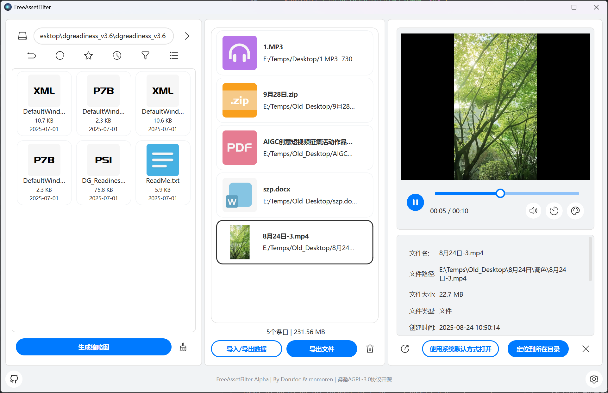

<p align="center"><strong>该项目将于不久后推出2.0版本，敬请期待。届时该项目将以全新面貌带来全新体验。</strong></p>

<div align="center">


# Sopeek

**一款强大的多功能文件预览与管理工具，让文件浏览如丝般高效顺滑**

[](https://github.com/Dorufoc/Sopeek/releases)
[](https://www.python.org/)
[](https://wiki.qt.io/Qt_for_Python)
[](LICENSE)
[](https://www.microsoft.com/windows)

[English](README_EN.md) • [功能预览](#-功能预览) • [快速开始](#-快速开始) • [功能特性](#-功能特性) • [安装指南](#-安装指南) • [使用说明](#-使用说明) • [技术架构](#-技术架构) • [开发指南](#-开发指南) • [贡献指南](#-贡献指南)



</div>

***


## 功能预览

### 核心亮点

- **极速启动** - 优化的预加载机制，秒级启动体验
- **专业预览** - 支持 100+ 种文件格式，覆盖图像、视频、音频、文档
- **三栏布局** - 文件浏览、筛选、预览一气呵成的高效工作流
- **深色模式** - 支持深色/浅色主题切换，呵护您的眼睛
- **高性能** - C++ 核心算法 + 异步加载，流畅不卡顿

***

## 快速开始

### 环境要求

| 项目         | 要求                    |
| ---------- | --------------------- |
| **操作系统**   | Windows 10/11 (64位)   |
| **Python** | 3.9 或更高版本             |
| **PySide6** | 6.10 或更高版本（无边框窗口基于 Qt 6.10+ 原生 ExpandedClientAreaHint） |
| **内存**     | 建议 4GB 以上             |
| **显卡**     | 支持 OpenGL 的显卡（用于视频播放） |

### 一键安装

```bash
# 克隆仓库
git clone https://github.com/Dorufoc/Sopeek.git
cd Sopeek

# 创建虚拟环境（推荐）
python -m venv venv
venv\Scripts\activate

# 安装依赖
pip install -r requirements.txt

# 运行应用
python -m sopeek.app.main
```

### 常见问题

<details>
<summary><b>启动时提示缺少 DLL 文件？</b></summary>

请安装 [Visual C++ Redistributable](https://aka.ms/vs/17/release/vc_redist.x64.exe) 后重试。

</details>

<details>
<summary><b>视频无法播放？</b></summary>

请确保显卡驱动已更新，并支持 OpenGL 3.0 以上版本。

</details>

<details>
<summary><b>安装依赖时报错，提示需要编译工具？</b></summary>

部分依赖包（如 `rawpy`、`numpy` 等）需要在本地编译，请确保已安装以下工具之一：

**方案一：安装 Microsoft C++ 生成工具（推荐）**

1. 下载 [Microsoft C++ 生成工具](https://visualstudio.microsoft.com/visual-cpp-build-tools/)
2. 安装"使用 C++ 的桌面开发"工作负载
3. 重新运行 `pip install -r requirements.txt`

**方案二：使用预编译 wheel 包**

```bash
# 先升级 pip
python -m pip install --upgrade pip

# 如果在特殊网络环境下，使用镜像加速下载预编译包
pip install -r requirements.txt -i https://pypi.tuna.tsinghua.edu.cn/simple
```

**方案三：安装 Visual Studio（完整版）**

- 安装 [Visual Studio Community](https://visualstudio.microsoft.com/downloads/)
- 选择"使用 C++ 的桌面开发"组件

</details>

***

## 功能特性

### 文件管理

| 功能          | 描述                 |
| ----------- | ------------------ |
| **智能文件浏览器** | 卡片式布局，支持缩略图显示，直观高效 |
| **文件临时存储池** | 快速收藏和整理选中文件，支持批量导出 |
| **多选与拖拽**   | 支持多文件选择、长按拖拽操作     |
| **路径导航**    | 快速跳转、历史记录、路径收藏     |
| **智能筛选**    | 按文件类型、日期、大小快速筛选    |

### 文件预览

| 类型      | 支持格式                                     | 特色功能            |
| ------- | ---------------------------------------- | --------------- |
| **图像**  | JPG, PNG, GIF, RAW, PSD, HEIC, AVIF, SVG | 便捷查看、色彩分析       |
| **视频**  | MP4, MOV, AVI, MKV, MXF                  | MPV 内核、LUT 实时预览 |
| **音频**  | MP3, WAV, FLAC, OGG, AAC                 | 元数据显示、高效播放      |
| **文档**  | PDF, DOCX, XLSX, PPTX, TXT, MD           | 完整预览、代码语法高亮     |
| **压缩包** | ZIP, RAR, 7Z, TAR                        | 无需解压即可查看内容      |
| **字体**  | TTF, OTF, WOFF                           | 实时渲染预览          |

### 个性化设置

- **主题系统** - 深色/浅色模式，支持自定义配色方案
- **DPI 自适应** - 完美支持 4K/8K 高分辨率屏幕
- **字体设置** - 可自定义界面字体和大小
- **缩略图缓存** - 智能缓存机制，提升浏览速度

### 性能优化

- **异步加载** - 缩略图后台生成，不阻塞主线程
- **C++ 扩展** - 核心算法使用 C++ 实现，性能卓越
- **内存管理** - 智能缓存清理，优化内存占用
- **启动加速** - 预加载机制，快速启动应用
- **独显加速** - 设置页开启「使用硬件加速」后，下次启动经独显启动器运行

### 功能对比

| 功能     | Sopeek | QuickLook | Seer   | Explorer |
| ------ | --------------- | --------- | ------ | -------- |
| 图像预览   | ✅ 100+ 格式       | ✅ 常见格式    | ✅ 常见格式 | ⚠️ 有限    |
| 视频播放   | ✅ 内置播放器         | ⚠️ 需插件    | ⚠️ 需插件 | ❌        |
| RAW 支持 | ✅ 完整支持          | ⚠️ 部分     | ⚠️ 部分  | ❌        |
| PSD 预览 | ✅ 图层支持          | ❌         | ❌      | ❌        |
| LUT 还原 | ✅ 实时预览          | ❌         | ❌      | ❌        |
| 操作布局   | ✅ 三栏布局          | ❌         | ❌      | ✅        |
| 开源免费   | ✅ AGPL-3.0      | ✅ GPL     | ❌ 付费   | ✅        |

***

## 支持的格式

### 图像格式 (30+)

| 类别         | 格式                                               |
| ---------- | ------------------------------------------------ |
| **常见格式**   | JPG, JPEG, PNG, GIF, BMP, WEBP, TIFF, SVG        |
| **现代格式**   | AVIF, HEIC, HEIF, JP2, JXR                       |
| **RAW 格式** | CR2, CR3, NEF, ARW, DNG, ORF, RAF, RW2, PEF, X3F |
| **专业格式**   | PSD, PSB, XCF, TGA, ICO, ICNS, DDS               |

### 视频格式 (20+)

| 类别       | 格式                                       |
| -------- | ---------------------------------------- |
| **常见格式** | MP4, MOV, AVI, MKV, WMV, FLV, WEBM       |
| **专业格式** | MXF, VOB, M2TS, TS, MTS, M2T, DV, ProRes |
| **移动设备** | 3GP, M4V, MPEG, MPG, HEVC, H.264         |

**视频功能**：

- 基于 MPV 的高性能播放
- 支持 LUT (.cube) 实时调色
- 速度控制
- 音量控制

### 音频格式 (10+)

MP3, WAV, FLAC, OGG, WMA, AAC, M4A, OPUS, AIFF, APE, MKA, AC3

**音频功能**：

- 元数据显示（ID3、专辑封面）
- 背景样式现代化

### 文档格式 (50+)

| 类别                  | 格式                                               |
| ------------------- | ------------------------------------------------ |
| **PDF**             | PDF（完整预览、缩放）                                     |
| **Office**              | DOC, DOCX, XLS, XLSX, PPT, PPTX（随应用自动安装，开箱即用） |
| **文本**              | TXT, MD, RST, RTF, CSV, JSON, XML, YAML          |
| **代码**              | Python, JavaScript, C++, Java, Go, Rust 等 50+ 语言 |

### 压缩包格式 (10+)

ZIP, RAR, 7Z, TAR, GZ, BZ2, XZ, LZMA, ISO, CAB, ARJ

### 字体格式 (5+)

TTF, OTF, WOFF, WOFF2, EOT

***

## 安装指南

### 方法一：预编译版本（推荐）

下载最新的预编译版本：

- [📦 下载 Windows 安装包](https://github.com/Dorufoc/Sopeek/releases)

### 方法二：从源码安装

#### 1. 克隆仓库

```bash
git clone https://github.com/Dorufoc/Sopeek.git
cd Sopeek
```

#### 2. 创建虚拟环境

```bash
python -m venv venv
venv\Scripts\activate  # Windows
```

#### 3. 安装依赖

```bash
pip install -r requirements.txt
```

#### 4. 构建 C++ 扩展（可选，仅 LUT 预览；仓库已含 cp39-x64 预编译版本）

```bash
# 构建 LUT 预览模块（MSVC 环境；MinGW 可改用 setup_mingw.py）
cd sopeek/core/native/src/cpp_lut_preview
python setup.py build_ext --inplace
```

#### 5. 运行应用

```bash
python -m sopeek.app.main
```

### 系统要求详情

| 组件       | 最低要求                        | 推荐配置                        |
| -------- | --------------------------- | --------------------------- |
| **操作系统** | Windows 10                  | Windows 11                  |
| **处理器**  | Intel Core i3 / AMD Ryzen 3 | Intel Core i5 / AMD Ryzen 5 |
| **内存**   | 4 GB RAM                    | 8 GB RAM                    |
| **存储**   | 900MB 可用空间                  | 1 GB 可用空间                   |
| **显卡**   | 具有视频加速的现代集成显卡               | Nvidia/AMD现代独立显卡            |

***

## 使用说明

### 界面布局

主界面提供两种布局，可在 **设置 → 通用 → 界面布局** 中切换（点击「确定」后立即生效），也可点击主界面**右上角的布局切换按钮**即时切换：

**新布局（预览优先，默认）**

```
┌──────────┬───────────────────────────────┐
│          │                               │
│  文件    │          文件预览              │
│  选择    │                               │
│          ├───────────────┬───────────────┤
│          │    文件储存    │   文件信息     │
└──────────┴───────────────┴───────────────┘
```

- 文件选择器独占左栏全高（默认占界面宽度 1/3，可拖拽调整；最小宽以顶栏/底栏
  完整显示图标与文字为准，网格列数随实际宽度自适应）；
- 预览区位于右上，**显示画布默认 16:9**：16:9 素材（如 4096×2304 图片）
  按窗口自适应时正好铺满显示区左右与上下（可拖拽调整 / 拖拽前随窗口缩放自动维持）；
  显示区最小 640×360（16:9），拖竖向分隔条只改高度、不反向调整宽度；
- 文件储存池以网格卡片展示（自动列数，默认最小缩放，Ctrl+滚轮可缩放），
  与文件信息面板并排位于预览区下方，两者默认各占界面宽度约 1/3（底行 50:50）；
  底行最小高度 = max(储存池一行卡片 + 其底栏, 信息面板最小高)；
- 复制到剪切板 / 系统打开 / 定位目录 / 清除预览等操作按钮位于预览器顶栏
  （视频、音频、Office 预览时同样提供统一工具栏）。

**经典三栏**

```
┌──────────────┬──────────────┬──────────────┐
│              │              │              │
│   文件选择器  │   文件储存池  │   文件预览器  │
│              │              │  （上：预览） │
│  • 浏览文件夹 │  • 收藏文件   │  （下：信息） │
│  • 缩略图显示 │  • 批量管理   │  • 全屏查看   │
│              │              │              │
└──────────────┴──────────────┴──────────────┘
```

两种布局的三处/五处分隔条均支持拖拽调整；底行（信息区）高度上限为右区可用高度的一半，保证预览区始终占主导。窗口被拖到过小尺寸时由主窗口最小尺寸兜底（不会再压到区域不可用：窗口小于各区域最小尺寸之和时停止缩放）。

- **最小尺寸口径**：右侧「预览器 + 信息」列的最小宽度以预览操作栏完整显示图标与文字为准（两个文字按钮各自压到最小宽）；信息面板最小宽 = 「修改时间」行单行完整显示，最小高 = 文件名 + 地址 + 首行信息 + 折叠入口行；
- **文件地址单行显示**，超长时中间省略；悬停提示与单击复制仍为全文；
- **折叠储存池**（经典布局）：把分隔条拖到储存池最小宽后继续拖动即把储存池折叠隐藏（只剩选择器与右列两栏），拖回即恢复；仅储存池可折叠，预览区/信息区不可。

> 经典布局下，预览操作栏（复制 / 系统打开 / 定位 / 清除）位于右列**最底部**
> （文件信息面板下方），与左侧文件选择器、文件储存池的底栏同底对齐；
> New 布局下这些操作移到预览器顶栏。经典布局三栏默认各占 **1/3** 宽度。

### 基本操作

| 默认操作     | 说明       |
| -------- | -------- |
| **左键单击** | 选中文件并预览  |
| **右键单击** | 打开上下文菜单  |
| **长按拖拽** | 将文件拖到存储池 |

### 文件选择器

- **导航栏**：快速切换目录、返回上级、刷新列表
- **空白区右键**：返回上一级（历史优先，与"返回上级"一致）
- **筛选器**：按文件类型快速筛选（图像/视频/音频/文档/全部）
- **排序**：按名称、日期、大小、类型排序
- **视图模式**：缩略图/列表模式切换

### 文件存储池

- **添加文件**：从选择器拖拽或点击添加按钮
- **清空池子**：一键清空所有文件
- **导出/导入数据**：将选中文件的路径数据文件进行存取
- **导出文件**：将选中文件导出到指定目录

### 文件预览器

- **自适应布局**：根据内容类型自动调整
- **详细信息**：显示文件元数据
- **操作按钮**：打开、复制文件、在文件夹中显示

## 技术架构

### 核心技术栈

```
Sopeek
├── GUI 框架: PySide6 (Qt6) - 跨平台图形界面
├── 图像处理: Pillow + rawpy - 图像解码与处理
├── 视频播放: MPV (libmpv) - 高性能视频播放
├── 音频处理: mutagen - 元数据读取
├── 压缩包: 7z.exe 命令行工具 - 归档文件处理
├── 语法高亮: Syntect + Pygments - 代码语法高亮
└── 扩展模块: C++/Rust (扫描/排序/哈希/EXIF/字体/高亮/Markdown/SVG/7z、缩略图、Mica 云母、LUT 预览) - 性能关键算法
```

### 项目结构

```
Sopeek/
├── sopeek/
│   ├── app/                    # 应用入口（main / startup / instance_guard）
│   ├── core/                   # 核心管理与原生桥
│   │   ├── managers/           # 设置 V2 / 心跳 / MPV / 缩略图管理器
│   │   ├── workers/            # 目录扫描、盘符枚举、存储池任务、缩略图控制器
│   │   ├── preview/            # 图像色彩工具、SVG 渲染器
│   │   └── native/             # 原生桥 bridges/、平台适配、bin/ 二进制、src/ Rust 与 C++ 源码
│   ├── services/               # 业务服务层（文件 / 预览 / Office / PDF / 图像解码 / 存储池等）
│   ├── ui/                     # 界面层（无边框窗口、主窗口）
│   │   ├── components/         # styled_* 组件库
│   │   ├── layout/             # 三栏布局与各预览器
│   │   ├── mica/               # Mica 云母背景引擎
│   │   └── theme/              # 主题系统
│   ├── utils/                  # 通用工具（路径 / 日志 / 高亮 / 性能埋点等）
│   ├── docs/                   # 第三方组件与许可证清单
│   └── icons/                  # 界面与文件类型图标资源
├── launcher/                   # 独显启动器（C 源码 + 构建脚本；SPK-Launcher.exe 本地构建，不入库）
├── installer_duilib/           # 自研安装器（C++/NSIS 源码与构建脚本）
├── scripts/                    # 辅助脚本（GUI 测试截图工具）
├── tests/                      # 测试体系（详见 tests/README.md）
├── data/                       # 运行期数据（本地生成、gitignore）：settings_v2.json、缩略图缓存、日志
├── requirements.txt            # Python 依赖清单
├── Pyinstall_build.py          # PyInstaller 打包脚本
├── README.md                   # 项目说明
└── LICENSE                     # 许可证
```

### 架构特点

- **MVC 模式**：清晰的模型-视图-控制器分离
- **单例模式**：核心管理器（设置、缩略图、播放器）
- **信号-槽机制**：组件间松耦合通信
- **多线程设计**：后台处理不阻塞 UI
- **插件化组件**：易于扩展新的文件类型支持

***

## 开发指南

### 开发环境搭建

#### 1. 克隆仓库并创建分支

```bash
git clone https://github.com/Dorufoc/Sopeek.git
cd Sopeek
git checkout -b feature/your-feature-name
```

#### 2. 安装开发依赖

```bash
python -m venv venv
venv\Scripts\activate
pip install -r requirements.txt
```

#### 3. 配置 IDE

推荐使用 VS Code 或 PyCharm，配置以下插件：

- Python 扩展
- Qt for Python 扩展
- Black 格式化工具

### 构建 C++ 扩展

```bash
# LUT 预览模块（唯一仍在维护的 C++ 扩展；MSVC 环境）
cd sopeek/core/native/src/cpp_lut_preview
python setup.py build_ext --inplace

# MinGW 环境改用：
python setup_mingw.py build_ext --inplace
```

### 代码规范

- **类型注解**：所有函数添加类型注解
- **文档字符串**：使用 Google Style Docstrings
- **命名规范**：
  - 类名：PascalCase
  - 函数/变量：snake\_case
  - 常量：UPPER\_SNAKE\_CASE

### 打包应用

发布链共三步（启动器可选）：构建独显启动器 → PyInstaller 生成安装器载荷 → 自研安装器打包。

```bash
# 1) 构建独显启动器（可选；构建后安装版才能启用「使用硬件加速」）
powershell -ExecutionPolicy Bypass -File launcher/build_launcher.ps1

# 2) 生成 PyInstaller 载荷 → build/pyinstall/Sopeek
python Pyinstall_build.py
# 可选参数：--no-clean 保留旧构建输出；--skip-build 仅清理与验证

# 3) 构建安装器（需要 CMake + MinGW + NSIS）
powershell -ExecutionPolicy Bypass -File installer_duilib/build.ps1
# 产物：build/installer/SopeekInstaller.exe、build/Sopeek_NSIS_Setup.exe
```

### 添加新的文件预览支持

1. **创建预览器布局** 在 `sopeek/ui/layout/preview/` 下新增布局类（可参考 `image_previewer_layout.py`），实现与统一预览器约定的入口方法 `set_file(path, ...)`；
2. **注册文件类型** 在 `sopeek/services/previewer_registry.py` 的 `_EXTENSION_MAP` 中登记「扩展名 → (模块路径, 类名)」映射（惰性导入，不影响首屏加载）；
3. **添加图标** 在 `sopeek/icons/` 添加文件类型图标（命名沿用 v3 多彩系列「X – 3.svg」）。

***

## 贡献指南

我们欢迎所有形式的贡献！无论是 Bug 修复、新功能、文档改进还是问题反馈。

### 贡献流程

1. **Fork 仓库** - 点击右上角的 Fork 按钮
2. **克隆仓库** - `git clone https://github.com/your-username/Sopeek.git`
3. **创建分支** - `git checkout -b feature/AmazingFeature`
4. **提交更改** - `git commit -m 'Add some AmazingFeature'`
5. **推送分支** - `git push origin feature/AmazingFeature`
6. **创建 Pull Request** - 在 GitHub 上提交 PR

### 代码规范

- ✅ 遵循 PEP 8 代码风格
- ✅ 添加类型注解
- ✅ 编写清晰的提交信息
- ✅ 更新相关文档
- ✅ 添加必要的测试

### PR 提交流程

1. 确保代码通过所有测试
2. 更新 README.md 中的相关文档
3. 在 PR 描述中说明更改内容
4. 关联相关的 Issue（如有）
5. 等待代码审查

### Issue 提交规范

- **Bug 报告**：描述问题、复现步骤、期望行为、实际行为
- **功能请求**：描述功能、使用场景、预期效果
- **问题咨询**：提供详细的环境信息和操作步骤

***

## 路线图

### 已完成功能

- [x] 基础文件浏览和预览
- [x] 图像格式支持（30+ 格式）
- [x] 视频播放功能（基于 MPV）
- [x] 音频播放和波形显示
- [x] PDF 和 Office 文档预览
- [x] 压缩包浏览
- [x] 字体预览
- [x] 深色/浅色主题切换
- [x] 文件存储池功能
- [x] 缩略图缓存系统
- [x] ISO文件稳定预览

### 计划中（未开始）

- [ ] 文件导出智能化分类（暂缓）
- [ ] 时间线与智能筛选工具（暂缓）
- [ ] 插件系统架构（暂缓）

### 可能会实现的功能

- [ ] macOS 和 Linux 支持
- [ ] 网络文件系统支持（SMB/NFS）
- [ ] AI 智能标签和分类
- [ ] 协作和分享功能
- [ ] 移动端&网页端配套应用

### 长期愿景

成为开源社区最强大的文件预览和管理工具，为创意工作者提供高效的数字资产管理解决方案。

***

## 安全说明

### 依赖安全

- 所有依赖库均来自官方 PyPI 仓库
- 定期更新依赖以修复安全漏洞
- 使用 `pip-audit` 进行依赖安全检查

### 漏洞报告

如果您发现了安全漏洞，请不要在公开 Issue 中披露，请发送邮件至：

<dorufoc@outlook.com>

我们会在 48 小时内回复，并尽快修复漏洞。

***

## 许可证

本项目基于 [AGPL-3.0](LICENSE) 许可证开源。

```
Sopeek - 多功能文件预览与管理工具
Copyright (c) 2026 Dorufoc <dorufoc@outlook.com>

This program is free software: you can redistribute it and/or modify
it under the terms of the GNU Affero General Public License as published
by the Free Software Foundation, either version 3 of the License, or
(at your option) any later version.

This program is distributed in the hope that it will be useful,
but WITHOUT ANY WARRANTY; without even the implied warranty of
MERCHANTABILITY or FITNESS FOR A PARTICULAR PURPOSE.  See the
GNU Affero General Public License for more details.
```

***

## 致谢

### 核心依赖

感谢以下开源项目的贡献：

#### GUI 框架

- [Qt for Python (PySide6)](https://wiki.qt.io/Qt_for_Python) - 跨平台 GUI 框架

#### 图像处理

- [Pillow](https://python-pillow.org/) - Python 图像处理库
- [pillow-heif](https://github.com/bigcat88/pillow_heif) - HEIF/HEIC 格式支持
- [pillow-avif](https://github.com/python-pillow/Pillow) - AVIF 格式支持
- [rawpy](https://github.com/letmaik/rawpy) - RAW 图像处理
- [psd-tools](https://github.com/psd-tools/psd-tools) - PSD 文件解析

#### 视频与音频

- [MPV](https://mpv.io/) - 高性能视频播放器
- [mutagen](https://mutagen.readthedocs.io/) - 音频元数据处理

#### 文档处理

- [Pygments](https://pygments.org/) - 代码语法高亮
- [Markdown](https://python-markdown.github.io/) - Markdown 解析

#### 压缩包处理

- [7-Zip](https://www.7-zip.org/) - 7z 格式开源实现与 LZMA/LZMA2 算法

#### 语法高亮

- [Syntect](https://github.com/trishume/syntect) - 高性能语法高亮引擎
- [vscode-textmate](https://github.com/microsoft/vscode-textmate) - TextMate 语法解析库

#### 科学计算

- [NumPy](https://numpy.org/) - 科学计算库

#### 文本与编码

- [chardet](https://github.com/chardet/chardet) - 字符编码检测
- [ExifRead](https://github.com/ianare/exif-py) - EXIF 数据读取

### 资源致谢

- 字体：使用 [Fira Code](https://github.com/tonsky/FiraCode) 作为代码字体
- 中文字体：使用庞门正道标题体

### 特别贡献者

感谢所有为项目做出贡献的开发者：

- [@Dorufoc](https://github.com/Dorufoc) - 项目创始人 & 核心开发者
- [@renmoren](https://github.com/renmoren) - 核心开发者

### 相关项目

- [mpv](https://github.com/mpv-player/mpv) - 命令行视频播放器
- [vscode-textmate](https://github.com/microsoft/vscode-textmate) - TextMate 语法解析库

***

<div align="center">

**⭐ 如果这个项目对您有帮助，请给我们一个 Star！**

[🐛 提交 Bug](https://github.com/Dorufoc/Sopeek/issues) • [💡 功能建议](https://github.com/Dorufoc/Sopeek/issues) • [🤝 参与贡献](https://github.com/Dorufoc/Sopeek/pulls)

Made with ❤️ by [Dorufoc](https://github.com/Dorufoc) & [renmoren](https://github.com/renmoren)

</div>
