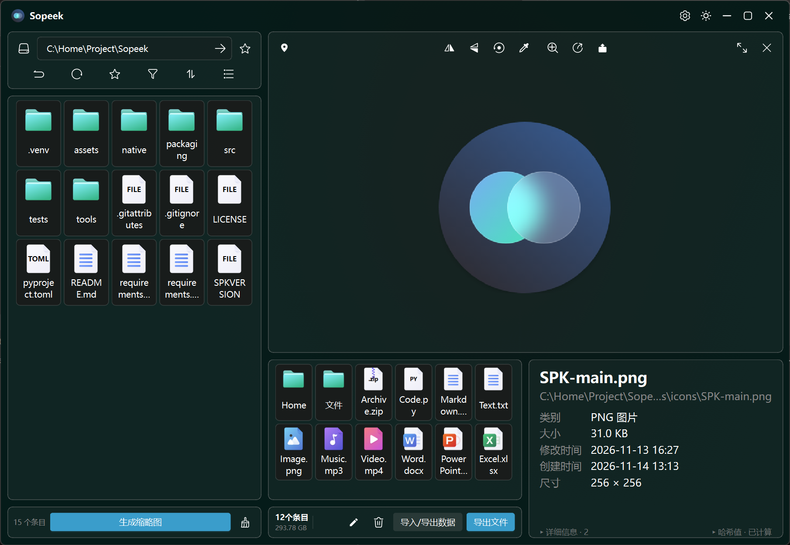
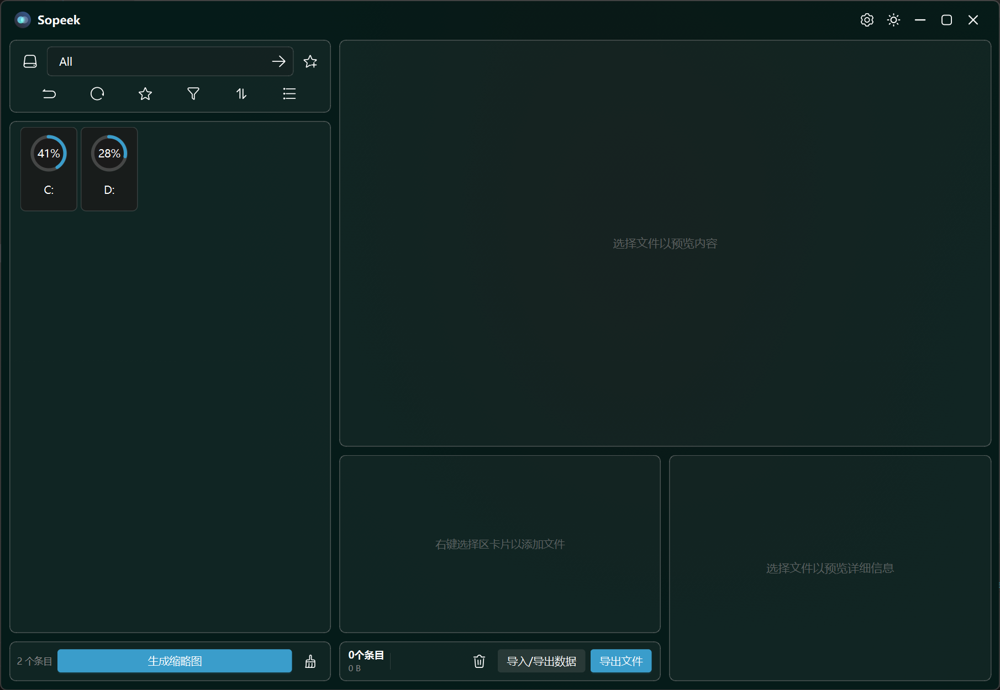
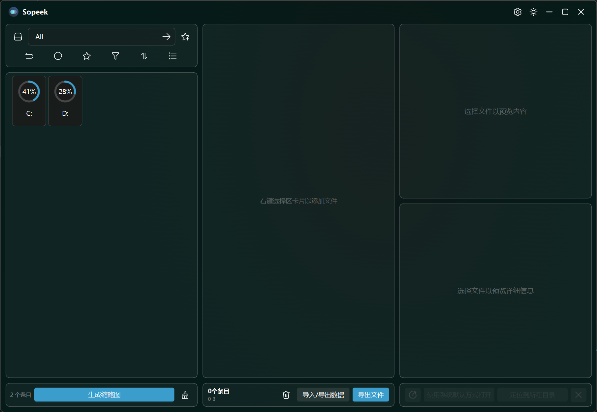

<div align="center">


# Sopeek

**A powerful, all-in-one file preview and management tool that makes browsing files silky smooth and efficient**

[](LICENSE)[](https://www.python.org/)[](https://wiki.qt.io/Qt_for_Python)[](https://www.microsoft.com/windows)

[简体中文](README.md) • [Quick Start](#quick-start) • [Features](#features) • [Supported Formats](#supported-formats) • [Usage](#usage) • [FAQ](#faq) • [Development Guide](#development-guide)



</div>

---

## Core Highlights

Sopeek is a desktop-grade file browsing, filtering and preview tool for Windows. It compresses "find a file → pick a file → look at a file" into a single workflow, ships with 8 previewer classes (image / video & audio / PDF / Office / text & code / archive / font / folder), and recognizes close to 100 extensions:

- **Browse**: card-style thumbnail and list views, rubber-band multi-select, drag-to-pool, favorites, history navigation;
- **Organize**: the asset pool supports renaming, batch export, path-data import/export, and automatic backups;
- **Preview**: full coverage of images, video, audio, PDF, Office, text/code, archives, fonts, and folders;
- **Keyboard-first**: focus-zone switching, file navigation, preview hand-off, pooling, filtering/sorting and playback control all work without a mouse;
- **Performance**: scanning, sorting, syntax highlighting, EXIF, hashing, encoding detection, SVG recoloring, 7z listing and other hot paths are handled by Rust / C++ native extensions.

| Capability | Description |
| -------------- | ------------------------------------------------------------ |
| **Unified workflow** | File browser + asset pool + previewer/info panel, with two layouts: "Classic" and "New" |
| **Multi-format preview** | 8 previewers covering images, video, audio, PDF, Office, text/code, archives, fonts, and folders |
| **Native acceleration** | `spk_core` (Rust) handles scanning/sorting/highlighting/Markdown/font parsing/hashing/encoding detection/EXIF/copying/SVG/7z listing; `thumbnail_generator` (Rust) handles thumbnail decoding |
| **Video playback** | Direct rendering through libmpv, with playback speed control, audio-track/subtitle switching, and a floating fullscreen control bar |
| **Global floating window** | A persistent circular asset-pool entry on the desktop, supporting file drops, click-to-expand, edge snapping, and position memory |

---

## Note

The repository has not been renamed yet; for any path involving the repository name, **please change it manually** to the original repository name: `FreeAssetFilter`

---

## Quick Start

### Option 1: Prebuilt installer (recommended)

[📦 Download the Windows installer](https://github.com/Dorufoc/Sopeek/releases)

The installer offers three maintenance paths: install, repair, and uninstall; uninstalling lets you optionally check "also delete user data (settings, cache, logs)".
The default install directory is `%ProgramFiles%\Sopeek`, and administrator privileges are required.

### Option 2: Run from source

Prebuilt artifacts for the native modules are included, so running from source needs no extra toolchain.

```bash
# 1. Clone the repository
git clone https://github.com/Dorufoc/Sopeek.git
cd Sopeek

# 2. Create and activate a virtual environment
python -m venv .venv
.venv\Scripts\activate

# 3. Install dependencies
pip install -r requirements.txt

# 4. Editable install (required for the src layout; afterwards the sopeek command works from any directory)
pip install -e .

# 5. Launch
python -m sopeek.app.main
```

If you prefer not to install, please put `src/` on the search path temporarily:

```bash
set PYTHONPATH=src
python -m sopeek.app.main
```

> The repository uses the `src/` layout: there is **no** `sopeek/` directory at the repository root, so running
> `python -m sopeek.app.main` directly from the root fails with `No module named sopeek`. Use one of the two approaches above.

### Command-line arguments

| Argument | Description |
| -------------------- | ---------------------------------------------------- |
| `--open-path <path>` | Navigate directly to the given directory on startup (when given a file, opens its parent directory) |

---

## Features

### File management

| Feature | Description |
| --- | --- |
| **Smart file browser** | Card-style thumbnail and list views, column count adapts to width, Ctrl+wheel to zoom |
| **Rubber-band multi-select** | Left-drag to rubber-band select; right-click a selected card to batch-add it to the asset pool |
| **Navigation and favorites** | Go up one level, refresh, jump to path, all-drives view, path favorites, history |
| **Filtering and sorting** | Case-insensitive regex filtering on file names; 8 sort orders (name/modified time/size/created time, each ascending or descending) |
| **Hidden-item control** | Optionally show hidden files and protected system files (two-level switch) |
| **Thumbnail management** | Background batch generation, on-demand cache clearing |
| **Asset pool** | Grid / list display, rename, delete, clear, export files, import/export path data, automatic backups |

### Previewer capabilities

| Previewer | Highlights |
| :-- | --- |
| **Image** | Asynchronous decoding, 50%–500% zoom, flip, rotate, color picker, GIF play/pause, fullscreen |
| **Video & audio** | libmpv rendering; Space to play/pause, arrow keys to seek/change volume, number keys for playback speed, audio-track and subtitle selection, floating fullscreen control bar; audio mode features a fluid background and a metadata panel |
| **PDF** | Native rendering, page jumping, 50%–300% zoom, thumbnail index drawer, text selection |
| **Office** | Automatic fallback chain MS Office / WPS COM → LibreOffice → pure Python; PDF when an external backend is available, otherwise docx→HTML, pptx→outline, xlsx→HTML table |
| **Text / code** | Markdown rendering, syntax highlighting, source/rendered toggle, fullscreen, in-app search drawer, font size 8–32 px |
| **Archive** | Browse entries without extracting, recursive search across the whole archive, password prompt on demand, extract selection/all (name clashes are auto-renamed, never overwritten) |
| **Font** | TTF/OTF/WOFF/WOFF2/EOT loading and rendering, font-size and weight adjustment (variable fonts supported) |
| **Folder** | Directory content listing, automatic watch-and-refresh, hidden/system item filtering |

### File info panel

The info panel below the preview area works in tandem with the previewer: file name, path, size, type, and created/modified times are always shown; "Details" expands according to file type (common EXIF subset plus image dimensions, video duration and picture parameters, audio tags, etc.), while "Hashes" computes MD5 / SHA1 / SHA256 in the background with progress reported in 1 MiB steps. Results are written to the shared cache `cache/file_info.json`, so reopening a file requires no recomputation.

### Personalization and performance

- **Performance tiers**: Performance / Balanced / Power Saver, uniformly constraining thread pools and cache limits;
- **Hardware acceleration**: optional discrete-GPU launcher (`SPK-Launcher.exe`) forces the high-performance adapter on hybrid-graphics machines;
- **Startup experience**: the window shows its first frame first, the three-column layout is built in stages, and all heavy work runs in the background;
- **Memory budget**: automatically selected based on available memory; VRAM is bounded by a texture limit;
- **Thread budget**: 5 named thread pools + the native rayon pool are all kept within 32 threads, so long tasks never starve the preview's first frame.

---

## Supported Formats

### Images

| Category | Formats |
| :-- | :-- |
| Common | JPG / JPEG / PNG / GIF / BMP / TIFF / WEBP / SVG / ICO / ICON |
| Modern | AVIF / HEIC / HEIF |
| RAW | CR2 / CR3 / CRW / NEF / NRW / ARW / DNG / ORF / SRF / SR2 / SRW / RAF / RW2 / PEF / PTX / X3F |
| Professional | PSD |

> The thumbnail and decoding layers additionally recognize more RAW variants such as 3FR, IIQ, and R3D; whether a format can be previewed is governed by the previewer registry.

### Video

MP4 / MOV / AVI / MKV / M4V / WMV / WEBM / MPG / OGV / RMVB / VOB / MXF / M2TS / MTS / TS / 3GP

> The player itself also supports FFmpeg-decodable containers such as FLV / MPEG (for manual file selection and future
> expansion), but the default preview mapping in the file list follows the registry entries listed above.

### Audio

MP3 / WAV / FLAC / OGG / WMA / M4A / OPUS / AIFF / APE

### Documents and code

| Category | Formats |
| --- | --- |
| PDF | PDF |
| Office | DOC / DOCX / XLS / XLSX / PPT / PPTX |
| Text | TXT / MD / RST |
| Code | PY / JAVA / CPP / C / H / CS / JS / HTML / CSS / PHP / GO / RB / SWIFT / KT / JSON / XML / YML / YAML, etc. |

> Code highlighting bundles 50+ TextMate grammar definitions (including Rust, Shell, SQL, Lua, Dart, Docker, Makefile, etc.) and can fall back to Pygments.

### Archives

ZIP / RAR / 7Z / TAR / GZ / TGZ / BZ2 / XZ / ISO

### Fonts

TTF / OTF / WOFF / WOFF2 / EOT

---

## Usage

### Interface layout

Switch under **Settings → General → Interface layout** (takes effect immediately after clicking "OK"):

**New layout**



- The file browser occupies the full height of the left column, taking about 1/3 of the window width by default;
- The preview area sits in the top right, with a **default 16:9 display canvas** that is maintained as the window resizes; the display area has a minimum of 640×360;
- The asset pool and the info panel sit side by side below the preview area, split **50 : 50** by default (i.e. roughly 1/3 of the window each); the bottom row's height is capped at half of the available height on the right;
- Unified action buttons (copy to clipboard / open with system default / reveal in folder / clear preview) live in the previewer's top bar.

**Classic three-column**



- The three columns each take 1/3 by default; in the right column the preview and info areas each take half the height by default, and the info area is capped at half of the available height on the right;
- The unified action bar sits at the very bottom of the right column and is bottom-aligned with the footers of the left and middle columns;
- Dragging a splitter to the asset pool's minimum width and continuing to drag collapses that column, and dragging back restores it (only the asset pool is collapsible).


**Common interactions**

All splitters are draggable; **double-clicking any splitter** resets the entire layout to the current mode's default proportions; when the window shrinks to the sum of each region's minimum size, resizing stops.

### Basic operations

| Operation | Description |
| --- | --- |
| Left click a file card | Select and preview it |
| Left drag a card / empty area | Rubber-band select multiple files |
| Right click a card not in the pool | Add to the asset pool |
| Right click a card already in the pool | Remove from the asset pool |
| Right click a selected card | Batch-add to the asset pool |
| Right click a pool card | Remove from the asset pool |
| Left click file info | Copy that entry |
| Right click file info | Copy all info |
| Drag a file onto the asset pool / floating window | Add to the asset pool |
| `Ctrl+wheel` (file browser / asset pool) | Zoom cards (asset pool: New layout only) |
| Double-click any splitter | Reset layout proportions |
| Mouse side "Back" button | Go to the parent directory in the file browser / archive preview |

### Keyboard shortcuts

All bindings use **physical key codes**, so Caps Lock, keyboard layout and Chinese IME state do not affect them. Bindings are fixed in this version and cannot be customized.

Keyboard-only workflow:

1. Use `Ctrl+arrows` or `F6` to move between focus zones: path box → file browser → preview → asset pool → info panel (in the classic layout the pool comes before the preview). The active zone flashes once; empty zones are skipped.
2. In the file browser, use the arrow keys to move and preview; `Enter` enters a folder or hands a file to the previewer.
3. `Tab` adds/removes the current item from the asset pool; `Alt+arrows` enters batch selection (in the file browser, batch `Tab` adds all selected; in the pool, it removes the whole batch).
4. `Ctrl+F` / `Ctrl+G` / `Ctrl+H` / `Ctrl+L` open filter, favorites, refresh and sort; `Q` / `Shift+Q` generate/clear thumbnails.
5. `Ctrl+\` enters/exits previewer fullscreen; `Esc` closes popups/drawers or steps back through the current zone.

#### Global keys and focus zones

| Key | Function |
| --- | --- |
| `Ctrl+I` | Open / close Settings |
| `Ctrl+M` | Reveal the current file in File Explorer |
| `Ctrl+K` | Open the current file with the system default app |
| `Ctrl+O` | Locate the current file inside the app |
| `Ctrl+→` / `Ctrl+↓` / `F6` | Next focus zone |
| `Ctrl+←` / `Ctrl+↑` / `Shift+F6` | Previous focus zone |

#### File browser

| Key | Function |
| --- | --- |
| `↑` / `↓` | Previous / next entry (including folders); holding only moves the highlight, preview loads on release |
| `←` / `→` | Previous / next entry in file order |
| `Enter` | Enter a folder; for a file, preview it and hand focus to the previewer |
| `Tab` | Add / remove the current item from the pool; in batch mode, add all selected |
| `Alt+arrows` | Enter batch selection and move one step |
| `Space` | Play / pause when the current preview is audio/video |
| `1` / `2` / `3` / backtick | Playback speed: short press switches and keeps; long press applies temporarily and restores on release |
| `Shift+←` / `Shift+→` | Seek back / forward 5 seconds (hold to repeat) |
| `Shift+↑` / `Shift+↓` | Volume +5 / −5 (hold to repeat) |
| `Ctrl+F` / `Ctrl+G` / `Ctrl+H` / `Ctrl+L` | Filter / favorites / refresh / sort |
| `Q` / `Shift+Q` | Generate / clear thumbnails for the current path |

> `Ctrl+F` / `Ctrl+G` / `Ctrl+H` / `Ctrl+L` work anywhere in the main window, not only when the file list has focus.

#### Asset pool

| Key | Function |
| --- | --- |
| `↑` / `↓` / `←` / `→` | Move through cards in visual order |
| `Enter` | Preview the current card and hand focus to the previewer |
| `Tab` | Remove the current card; in batch mode, remove all selected (confirmation required) |
| `Alt+arrows` | Batch selection |
| `Space` / `1` / `2` / `3` / backtick | Play/pause and playback speed |
| `Shift+←` / `Shift+→` / `Shift+↑` / `Shift+↓` | Seek back / forward 5 seconds, volume −5 / +5 |
| `Q` / `Shift+Q` | Generate / clear thumbnails for pool items |

#### File info panel

| Key | Function |
| --- | --- |
| `↑` / `↓` | Move between copyable entries |
| `Enter` | Copy the highlighted entry |
| `Ctrl+Enter` | Copy all information for the current file |

#### Previewers

| Previewer | Keys | Function |
| --- | --- | --- |
| Image | `←` / `→` | Previous / next file (folders skipped, wraps around) |
| Image | `+` / `=` / `-` / `0` | Zoom in / out / fit to window (50%–500%) |
| Image | `R` / `H` / `V` | Rotate clockwise / flip horizontally / flip vertically |
| Image | `I` / `Space` | Color picker / GIF play-pause |
| Video & audio | `Space` / `M` | Play-pause / mute toggle |
| Video & audio | `←` / `→` / `↑` / `↓` | Seek back / forward 5 seconds, volume ±5 |
| Video & audio | `1` / `2` / `3` / backtick | Playback speed (short press switches / long press temporary) |
| PDF | `↑` / `↓` / `PageUp` / `PageDown` | Scroll / previous page / next page |
| PDF | `+` / `-` / `0` | Zoom in / out / fit page width |
| PDF | `Shift+F` / `Ctrl+C` | Toggle index drawer / copy selected text |
| Text & code | `↑` / `↓` / `+` / `-` / `Ctrl+0` | Scroll / font size ±1 / reset font size |
| Text & code | `Shift+F` / `Ctrl+E` | Search drawer / source-rendered toggle |
| Font | `←` / `→` / `+` / `-` | Weight −/+ and size −/+ |
| Archive | `Shift+F` / `Enter` | Search the whole archive / enter the selected directory |
| Folder | `Enter` | Enter the selected subdirectory |

> Image, video/audio, PDF, text and font previewers use `Ctrl+\` (on Chinese keyboards, `Ctrl+、`) to enter/exit fullscreen; archive and folder previews have no fullscreen.

#### Dialogs and controls

| Key | Function |
| --- | --- |
| `Esc` | Close dialog / drawer / dropdown |
| `Enter` | Activate the focused button; when focus is not on a button, activate the primary button |
| `↑` `↓` `←` `→` | Move focus between controls by geometric proximity |
| `Tab` / `Shift+Tab` | Move along the default focus chain |
| `Space` / `Enter` | Toggle a checkbox |
| `↑` / `↓` | Change the current value when a combo box is collapsed; move the highlight when expanded |
| `Space` / `Enter` | Open the dropdown; `Enter` selects the highlighted item when expanded |
| `←` `→` `Home` `End` | Switch segments |

#### How `Esc` steps back

- **Global**: close the topmost drawer → close the dialog (same as cancel) → exit fullscreen.
- **File browser**: cancel path editing → exit batch selection (keep selection) → clear rubber-band selection → go to parent.
- **Asset pool**: exit rename mode → exit batch selection (keep selection) → clear rubber-band selection.
- **Archive / folder preview**: exit search / go to parent; at the root, hand focus back to the zone you came from.
- **Image preview**: exit color-picker mode.
- **PDF / text preview**: close the index or search drawer.
- **Video/audio, Office, etc.**: bubble up to the main window, which clears rubber-band selection.

#### Notes

- When any popup is open (context menu, dropdown, dialog, drawer, floating panel), global and zone keys are silent by default. Only toggle keys such as filter, favorites, sort and search drawers may pass through. When a `QMenu` is open, only the sort menu `Ctrl+L` can toggle it closed; all other keys are left to menu navigation.
- When focus is inside an editable input (filter box, path box, search box, AI input), printable characters are reserved for typing. `Shift+F` only types an uppercase `F`; use `Ctrl+Shift+F` or press `Esc` to leave the input before toggling a drawer.
- In the main window, `Tab` is bound to add/remove from the asset pool and cannot move focus; use `Ctrl+arrows` / `F6`. In dialogs and the Settings window, `Tab` still follows the default focus chain.
- `Esc` in image, video/audio, PDF, text and font previewers only handles that previewer's sub-state and does not return focus to the file browser; use `Ctrl+←` / `F6`. Only archive/folder previews return focus at their root.
- Keyboard-only covers browsing, previewing, pooling, filtering/sorting and playback control in the main window. Switching Settings sidebar tabs, pool rename/import/export, the previewer top-bar copy/clear buttons, all sliders and drag gestures still require a mouse.

### User data location

All runtime data lives in:

```
%LOCALAPPDATA%\Sopeek\data
```

The directory is split by purpose; only `config/` and `assets/` hold irreplaceable user data:

```
data/
├─ config/           # settings, AI accounts, favorites
├─ assets/           # background image, LUT files
├─ state/            # last path, staging pool, update state, runtime instance
├─ cache/            # thumbnails, icons, Office conversions, LUT previews, file info
├─ logs/             # runtime logs (200MB cap, 7-day compression, 20-day archive cleanup)
├─ updates/download/ # installer downloads
├─ diagnostics/      # performance snapshots and diagnostics
└─ temp/office/      # Office conversion temp files (purged after 24 hours)
```

Deleting `cache/`, `logs/`, `diagnostics/`, `temp/`, or `updates/` loses no settings or user assets — the app rebuilds them automatically.

Source runs and the installed build share the same data directory; in test environments `SPK_DATA_DIR` redirects it to a temporary directory so real data is never touched. Files left in the old flat layout are migrated automatically on first launch.

---

## FAQ

**▷ Missing DLL on startup?**

Install the [Visual C++ Redistributable](https://aka.ms/vs/17/release/vc_redist.x64.exe).
If the missing file is a bundled one such as `libmpv-2.dll`, the working copy is incomplete (`src/sopeek/core/native/bin/` was emptied); just check that directory out again.

**▷ `No module named sopeek`?**

The repository uses the `src/` layout. Run `pip install -e .` first, or temporarily `set PYTHONPATH=src`.

**▷ Video won't play?**

Make sure `src/sopeek/core/native/bin/libmpv-2.dll` exists; if the graphics driver is too old, disable "Use hardware acceleration" in Settings to fall back to software rendering.

**▷ Office document preview fails?**

Legacy binary formats (doc/xls/ppt) rely on MS Office / WPS or LibreOffice; docx/pptx/xlsx can fall back to pure-Python rendering when no external backend is available (docx→HTML, pptx→text outline, xlsx→HTML table). The xlsx fallback only shows the first rows/columns and does not preserve charts, images, or merged-cell layout.A PPTX with zero slides shows an empty state directly without launching PowerPoint.

Office previews prefer the local Office suite through COM. Office may start minimized in the background and exits automatically when conversion finishes; LibreOffice is used as a fallback when COM is unavailable or conversion fails. To avoid starting Office entirely, make COM unavailable (for example, uninstall Office/WPS) and use LibreOffice only. When conversion fails, click "Copy error info" in the error view to copy a full diagnostic report (version, file, backend, technical details and log path). 

**▷ Installing dependencies fails, asking for build tools?**

Some dependencies (such as `rawpy` and `numpy`) may require local compilation:

1. Install [Microsoft C++ Build Tools](https://visualstudio.microsoft.com/visual-cpp-build-tools/) and check "Desktop development with C++";
2. Upgrade pip and try again: `python -m pip install --upgrade pip`;
3. On restricted networks, use a mirror: `pip install -r requirements.txt -i https://pypi.tuna.tsinghua.edu.cn/simple`.


**▷ Changes to icons / syntax files don't take effect?**

Runtime resources live in `src/sopeek/resources/`, and all paths are resolved by `sopeek/_paths.py`; after packaging, resources live in `_internal/sopeek/resources/`.

---

## Technical Architecture

### Tech stack

| Layer | Technology |
| --- | --- |
| GUI | PySide6 (Qt 6.10) + custom frameless window, Mica engine, styled component library |
| Imaging | Pillow, pillow-heif, pillow-avif-plugin, rawpy, psd-tools, NumPy |
| Video / audio | libmpv (direct rendering), mutagen, FFmpeg / ffprobe |
| Documents | PyMuPDF, python-docx, openpyxl, python-pptx, mammoth, Markdown |
| Archives | 7-Zip (`7z.exe`) command line + native listing interface |
| Highlighting | Native `spk_core` highlighting + TextMate grammars (50+ languages) + Pygments fallback |
| Native extensions | Rust (scanning/sorting/highlighting/hashing/EXIF/fonts/SVG/7z/PDF text selection/directory streaming), Rust (thumbnail decoding), C++ (Mica rendering, LUT preview) |
| Packaging | PyInstaller onedir + custom C++ installer (MinGW/CMake) + NSIS |

### Project structure

```
.
├── src/sopeek/                  # The only importable root (Python package)
│   ├── _paths.py                # Single source of truth for all paths
│   ├── _import_compat.py        # Convergence between theme/components short paths ↔ sopeek.ui.*
│   ├── app/                     # Entry point, startup orchestration, single-instance guard, pending updates
│   ├── core/
│   │   ├── managers/            # Settings V2 / heartbeat / MPV / thumbnails
│   │   ├── workers/             # Directory scanning, drive enumeration, asset pool tasks, thumbnail controller
│   │   ├── preview/             # Image color utilities, SVG renderer
│   │   └── native/              # Native bridge, platform adapters, bin/ runtime binaries
│   ├── services/                # Previewer registry, file info, Office/PDF, updates, AI, etc.
│   ├── ui/
│   │   ├── components/          # styled_* component library (60+ widget modules)
│   │   ├── layout/              # Three-column layout, individual previewers, settings pages
│   │   ├── mica/                # Mica background engine
│   │   └── theme/               # Theme tokens and stylesheets
│   ├── utils/                   # Paths, logging, syntax highlighting, LUT, version info, etc.
│   └── resources/               # icons / syntax / shaders / docs (shipped with the package)
├── native/                      # Native sources (build inputs, not imported)
│   ├── spk_core/                #   Rust cdylib: scanning/sorting/highlighting/hashing/EXIF…
│   ├── thumbnail_rust/          #   Rust cdylib: thumbnail decoding
│   ├── spk_updater/             #   Rust exe: update sidecar (NDJSON over stdio)
│   ├── cpp_mica_render/         #   C++/MSVC: D3D11 Mica rendering
│   └── cpp_lut_preview/         #   C++/pybind11: LUT preview extension
├── packaging/
│   ├── build.py                 # PyInstaller packaging entry point
│   ├── runtime_compat.py        # Frozen-runtime hooks
│   ├── installer/               # C++ installer + NSIS script
│   └── launcher/                # Discrete-GPU launcher SPK-Launcher.exe
├── tools/                       # Smoke tests, updater integration, brand checks, screenshot tools
├── assets/                      # Brand images and screenshots used by the README
├── tests/                       # Unit / integration tests and binary fixtures
├── pyproject.toml               # Project metadata + ruff + pytest configuration
├── requirements.txt / requirements-dev.txt
├── SPKVERSION                   # The single runtime version source
└── LICENSE
```

### Architecture notes

- **Service/UI separation**: `services/` owns data, protocols, and background task orchestration, while UI state and widget construction stay in `ui/`; the two sides communicate through signals and slots;
- **Native is optional**: all native capabilities are accessed through `sopeek.core.native.api`; a missing DLL or missing export returns `False`/`None` and falls back to the Python implementation, **never crashing the process**;
- **Staged isolation**: every change in the settings pages is first written to a staging cache, and only applied to the runtime and persisted when "OK" is clicked;
- **Thread budget**: named thread pools (interactive / decode / io / net / background) + the native rayon pool, with a controlled total;
- **Single instance**: mutex + runtime instance info; duplicate launches exit silently.

---

## Requirements

| Item | Requirement |
| -------- | ------------------------------------------------------------ |
| OS | Windows 10 / 11 (64-bit) |
| Python | 3.9 or later (both development and packaging are validated against 3.9) |
| PySide6 | 6.10 or later (the frameless window relies on native capabilities in Qt 6.10) |
| Runtime | [Visual C++ Redistributable 2015–2022 x64](https://aka.ms/vs/17/release/vc_redist.x64.exe) |
| GPU | OpenGL-capable graphics card (video playback and fluid background) |

> Runtime binaries (`libmpv-2.dll`, `spk_core.dll`, `thumbnail_generator.dll`, `ffmpeg.exe`, `7z.exe`, etc.) ship with the package, so a fresh clone runs **without any Rust / C++ toolchain**.

---

## Development Guide

### Development environment

```bash
pip install -r requirements.txt -r requirements-dev.txt
pip install -e .
```

### Common commands

```bash
# Lint (only defect-class rules E9 + F are enabled)
ruff check .

# Compile check
python -m compileall -q src

# Smoke tests: full import + offscreen main-window launch
python tools/smoke_app.py
python tools/smoke_app.py --imports   # imports only
python tools/smoke_app.py --app       # offscreen launch only
```

### Testing

```bash
pytest                       # skips the gui marker by default
pytest -m unit               # unit tests only
pytest -m integration        # cross-module integration tests
pytest tests/unit/utils -v   # a specific directory
```

- The `tests/` hierarchy mirrors `src/sopeek/`;
- `tests/conftest.py` automatically injects `src/` into `sys.path` and redirects `SPK_DATA_DIR` to a temporary directory;
- Qt tests use the offscreen backend (`QT_QPA_PLATFORM=offscreen`); tests that need a real display use `@pytest.mark.gui`;
- `tests/fixtures/` holds non-regenerable binary fixtures (media, thumbnails, encoding samples).

### Version numbers

`SPKVERSION` is the single runtime version source (the update check reads it; the first line is the version, the second the build date);
the `version` in `pyproject.toml` only serves local `pip install -e .` and does not need to be updated in sync when releasing.
`sopeek.__version__` is read from `SPKVERSION` during package initialization.

### Building native modules

All artifacts are installed back into `src/sopeek/core/native/bin/`

> `cargo build` only produces `native/spk_core/target/release/spk_core.dll`; it does **not** automatically overwrite the runtime directory. The application loads `src/sopeek/core/native/bin/spk_core.dll` first, so copy the artifact manually after building and verify its timestamp/hash. `build.cmd` does not rebuild Rust modules either. A Low-integrity (Low IL) terminal may be unable to write that directory due to no-write-up, leaving the old DLL in use.

```bash
# Rust (requires cargo)
cargo build --release --manifest-path native/spk_core/Cargo.toml
cargo build --release --manifest-path native/thumbnail_rust/Cargo.toml
python native/spk_updater/build_updater.py      # build and install spk_updater.exe

# C++ (requires MSVC / Windows SDK)
python native/cpp_mica_render/build.py          # build and install mica_render.dll
python native/cpp_lut_preview/setup.py build_ext --inplace   # LUT extension (optional)

# Discrete-GPU launcher (MSVC or MinGW)
powershell -ExecutionPolicy Bypass -File packaging/launcher/build_launcher.ps1
```

### One-click build (recommended)

Double-click `build.cmd` in the repository root. It runs the full release chain: PyInstaller payload, CMake + MinGW installer GUI, NSIS packaging, and artifact verification. Logs are written to `build/logs/build-<timestamp>.log`, and the window always stays open.

If the repository path contains non-ASCII characters, the script warns that CMake + MinGW cannot build there but keeps going by mirroring the workspace into an ASCII temporary directory: C: is preferred, then D:/E: when C: has less than 5 GB free, and it fails only when no local disk has 5 GB free and is writable. Artifacts are copied back to `build\` on success; the temporary workspace is kept on failure for diagnosis.

Dependencies are not installed automatically. Prepare them first:

```powershell
python -m venv .venv
.venv\Scripts\python.exe -m pip install -r requirements.txt
.venv\Scripts\python.exe -m pip install pyinstaller==6.22.3
```

> Do not confuse the three artifacts:
>
> - `build\pyinstall\Sopeek\Sopeek.exe` is the application payload, not the installer;
> - `build\installer\SopeekInstaller.exe` is the installer UI component and cannot run standalone;
> - `build\Sopeek-<version>-windows-x64-<timestamp>.exe` is the final installer (timestamp is the build time as `yyMMddHHmmss`, e.g. `Sopeek-2.0.0-windows-x64-261118153045.exe`).

### Packaging and installer

```bash
# 1. PyInstaller onedir packaging (output in build/pyinstall/Sopeek)
python packaging/build.py
# Optional: --no-clean keeps the previous output; --skip-build only cleans and verifies

# 2. Installer bootstrap (requires CMake + MinGW)
powershell -ExecutionPolicy Bypass -File packaging/installer/build.ps1

# 3. NSIS installer (build.ps1 calls makensis as its last step)
#    Artifacts: build/installer/SopeekInstaller.exe → build/Sopeek-<version>-<platform>-<arch>-<timestamp>.exe
#    e.g. build/Sopeek-2.0.0-windows-x64-261118153045.exe
#    (timestamp = local build time as yyMMddHHmmss, two-digit year)
```

For installer architecture, cross-process protocols, maintenance/uninstall flows and QA details,
see [`packaging/installer/INSTALLER_ARCHITECTURE.md`](packaging/installer/INSTALLER_ARCHITECTURE.md).

### Adding preview support for a new file type

1. Add a previewer layout class under `src/sopeek/ui/layout/preview/` implementing the entry method `set_file(path, ...)`;
2. Register "extension → (module path, class name)" in `_EXTENSION_MAP` in `src/sopeek/services/previewer_registry.py` (lazy import, so the first paint is unaffected);
3. Add a file-type icon under `src/sopeek/resources/icons/` (following the "X – 3.svg" naming convention).

### Coding standards

- Follow PEP 8 and add type annotations to functions;
- Use Google Style for docstrings;
- PascalCase for class names, snake_case for functions/variables, UPPER_SNAKE_CASE for constants;
- Conventional Commits are recommended for commit messages (`feat:` / `fix:` / `refactor:` / `docs:`).

---

## Contributing

We welcome contributions of every kind — bug fixes, new features, documentation improvements, or issue reports.

### Contribution workflow

1. **Fork the repository** - Click the Fork button in the top-right corner
2. **Clone the repository** - `git clone https://github.com/Dorufoc/Sopeek.git`
3. **Create a branch** - `git checkout -b feature/AmazingFeature`
4. **Commit your changes** - `git commit -m 'Add some AmazingFeature'`
5. **Push the branch** - `git push origin feature/AmazingFeature`
6. **Open a Pull Request** - Submit the PR on GitHub

### Coding standards

- ✅ Follow the PEP 8 style
- ✅ Add type annotations
- ✅ Write clear commit messages
- ✅ Update the relevant documentation
- ✅ Add the necessary tests

### PR process

1. Make sure the code passes all tests
2. Update the relevant documentation in README.md
3. Describe the changes in the PR description
4. Link the related issue(s), if any
5. Wait for code review

### Issue guidelines

- **Bug report**: describe the problem, reproduction steps, expected behavior, and actual behavior
- **Feature request**: describe the feature, the use case, and the expected outcome
- **Question**: provide detailed environment information and the steps you took

---

## Security

### Project security

- All dependencies come from the official PyPI;
- Update packages are verified with SHA-256 after download;
- AI account keys are stored encrypted with Windows DPAPI;

### Vulnerability reporting

- If you discover a security vulnerability, please do not disclose it in a public issue. Instead, email: [dorufoc@outlook.com](mailto:dorufoc@outlook.com)
- We will respond within 48 hours and fix the vulnerability as soon as possible.

---

## Acknowledgements

### Core dependencies

- [Qt for Python (PySide6)](https://wiki.qt.io/Qt_for_Python) — cross-platform GUI framework
- [Pillow](https://python-pillow.org/) / [pillow-heif](https://github.com/bigcat88/pillow_heif) / [pillow-avif-plugin](https://github.com/bigcat88/pillow_avif) / [rawpy](https://github.com/letmaik/rawpy) / [psd-tools](https://github.com/psd-tools/psd-tools) — image decoding
- [mpv](https://mpv.io/) — video playback core
- [FFmpeg](https://ffmpeg.org/) — media probing and transcoding
- [7-Zip](https://www.7-zip.org/) — archive handling
- [PyMuPDF](https://pymupdf.readthedocs.io/) — PDF rendering
- [Pygments](https://pygments.org/) / [Syntect](https://github.com/trishume/syntect) — syntax highlighting
- [NumPy](https://numpy.org/) — numerical computing
- [mutagen](https://mutagen.readthedocs.io/) — audio metadata
- [chardet](https://github.com/chardet/chardet) / [ExifRead](https://github.com/ianare/exif-py) — encoding detection and EXIF
- Full third-party licensing is available in [`src/sopeek/resources/docs/THIRD_PARTY_NOTICES.md`](src/sopeek/resources/docs/THIRD_PARTY_NOTICES.md)

### Fonts

- [Fira Code](https://github.com/tonsky/FiraCode) — code font
- Pangmen Zhengdao Title Font — Chinese title font

### Long-term vision

To become one of the most usable file preview and digital asset management tools in the open-source community, giving creative professionals an efficient, restrained desktop experience.

### Contributors

- [@Dorufoc](https://github.com/Dorufoc) — Founder & core developer
- [@renmoren](https://github.com/renmoren) — Core developer

---

## License

This project is open-sourced under [AGPL-3.0](LICENSE).

```
Sopeek - A multi-purpose file preview and management tool
Copyright (c) 2026 Dorufoc <dorufoc@outlook.com>

This program is free software: you can redistribute it and/or modify
it under the terms of the GNU Affero General Public License as published
by the Free Software Foundation, either version 3 of the License, or
(at your option) any later version.

This program is distributed in the hope that it will be useful,
but WITHOUT ANY WARRANTY; without even the implied warranty of
MERCHANTABILITY or FITNESS FOR A PARTICULAR PURPOSE.  See the
GNU Affero General Public License for more details.
```

---

<div align="center">

**⭐ If this project helps you, please give us a Star!**

Made with ❤️ by [Dorufoc](https://github.com/Dorufoc) & [renmoren](https://github.com/renmoren)

</div>
